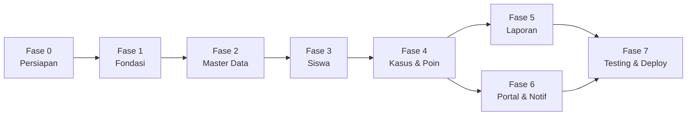

# Dokumentasi Implementasi
# Sistem Informasi Buku Kasus (SIBUKA)
### SMK TI Bali Global Klungkung

| Item | Keterangan |
|------|------------|
| **Nama Sistem** | SIBUKA — Sistem Informasi Buku Kasus |
| **Dokumen Terkait** | [TECHNICAL_DOCUMENTATION.md](./TECHNICAL_DOCUMENTATION.md) |
| **Framework** | Laravel 13.x |
| **Versi Dokumen** | 1.1.0 |
| **Tanggal** | 31 Juli 2026 |
| **Status** | Fase 7 — siap UAT & deploy |
| **UI Template** | SB Admin 2 — folder `template/` |

---

## Daftar Isi

1. [Tujuan Dokumen](#1-tujuan-dokumen)
2. [Prasyarat & Setup Awal](#2-prasyarat--setup-awal)
3. [Urutan Implementasi](#3-urutan-implementasi)
4. [Fase 0 — Persiapan Proyek](#4-fase-0--persiapan-proyek)
5. [Fase 1 — Fondasi (Auth, DB, RBAC)](#5-fase-1--fondasi-auth-db-rbac)
6. [Fase 2 — Master Data](#6-fase-2--master-data)
7. [Fase 3 — Manajemen Siswa](#7-fase-3--manajemen-siswa)
8. [Fase 4 — Manajemen Kasus & Poin](#8-fase-4--manajemen-kasus--poin)
9. [Fase 5 — Dashboard & Laporan](#9-fase-5--dashboard--laporan)
10. [Fase 6 — Portal Orang Tua & Notifikasi](#10-fase-6--portal-orang-tua--notifikasi)
11. [Fase 7 — Testing & Deployment](#11-fase-7--testing--deployment)
12. [Checklist Penerimaan Modul](#12-checklist-penerimaan-modul)
13. [Troubleshooting](#13-troubleshooting)
14. [Changelog Implementasi](#14-changelog-implementasi)

---

## 1. Tujuan Dokumen

Dokumen ini adalah **panduan implementasi praktis** untuk membangun SIBUKA dari awal. Berbeda dengan [TECHNICAL_DOCUMENTATION.md](./TECHNICAL_DOCUMENTATION.md) yang menjelaskan *what* dan *why*, dokumen ini fokus pada **how** — langkah demi langkah, file per file, command per command.

### Pembaca Target

- Developer yang mengimplementasikan sistem
- Mahasiswa KP yang mengerjakan coding
- Reviewer yang memverifikasi kelengkapan fitur

### Konvensi

| Simbol | Arti |
|--------|------|
| `[ ]` | Task belum selesai |
| `[x]` | Task selesai |
| **WAJIB** | Harus diselesaikan sebelum lanjut fase berikutnya |
| **OPSIONAL** | Boleh ditunda ke iterasi berikutnya |

---

## 2. Prasyarat & Setup Awal

### 2.1 Software yang Harus Terinstall

| Software | Versi | Verifikasi |
|----------|-------|------------|
| PHP | 8.3+ | `php -v` |
| Composer | 2.x | `composer -V` |
| Node.js | 20.x+ | `node -v` |
| npm | 10.x+ | `npm -v` |
| MySQL / MariaDB | 8.0 / 10.6 | `mysql --version` |
| Git | 2.x | `git --version` |

### 2.2 Extension PHP Wajib

Pastikan extension berikut aktif (`php -m`):

```
pdo_mysql, mbstring, openssl, tokenizer, xml, ctype, json, bcmath, fileinfo
```

### 2.3 Setup Database

```sql
CREATE DATABASE sibuka CHARACTER SET utf8mb4 COLLATE utf8mb4_unicode_ci;
CREATE USER 'sibuka_user'@'localhost' IDENTIFIED BY 'password_kuat';
GRANT ALL PRIVILEGES ON sibuka.* TO 'sibuka_user'@'localhost';
FLUSH PRIVILEGES;
```

### 2.4 Clone & Install Dependencies

```bash
cd C:\work\cus_ayik\SIBUKA

composer install
npm install

cp .env.example .env
php artisan key:generate
```

### 2.5 Konfigurasi `.env` untuk Development

```env
APP_NAME=SIBUKA
APP_ENV=local
APP_DEBUG=true
APP_URL=http://localhost:8000
APP_LOCALE=id
APP_FALLBACK_LOCALE=id

DB_CONNECTION=mysql
DB_HOST=127.0.0.1
DB_PORT=3306
DB_DATABASE=sibuka
DB_USERNAME=sibuka_user
DB_PASSWORD=password_kuat

SESSION_DRIVER=database
QUEUE_CONNECTION=database
CACHE_STORE=database

MAIL_MAILER=log
MAIL_FROM_ADDRESS=noreply@sibuka.local
MAIL_FROM_NAME="${APP_NAME}"

SIBUKA_SCHOOL_NAME="SMK TI Bali Global Klungkung"
SIBUKA_POINT_WARNING=-25
SIBUKA_POINT_SP1=-50
SIBUKA_POINT_SP2=-75
SIBUKA_POINT_SP3=-100
```

### 2.6 Jalankan Development Server

```bash
composer run dev
# atau terpisah:
# php artisan serve
# npm run dev
```

Akses: `http://localhost:8000`

---

## 3. Urutan Implementasi

Implementasi **harus** mengikuti urutan fase berikut. Setiap fase bergantung pada fase sebelumnya.



| Fase | Estimasi | Deliverable Utama |
|------|----------|-------------------|
| 0 | 0.5 hari | Dependencies, salin asset SB Admin 2, layout Blade dasar |
| 1 | 2–3 hari | Login (SB Admin 2), migration, RBAC, sidebar layout |
| 2 | 2 hari | CRUD jurusan, kelas, jenis kasus, user |
| 3 | 2–3 hari | CRUD siswa + import |
| 4 | 3–4 hari | CRUD kasus + PointService |
| 5 | 2–3 hari | Dashboard + laporan PDF/Excel |
| 6 | 2 hari | Portal orang tua + notifikasi |
| 7 | 3–4 hari | Tests, UAT, deploy |

**Total estimasi:** 10–12 minggu kerja praktek (part-time)

---

## 4. Fase 0 — Persiapan Proyek

### 4.1 Install Package Dependencies

```bash
# Export laporan
composer require barryvdh/laravel-dompdf
composer require maatwebsite/excel
```

> **Catatan UI:** SIBUKA **tidak** menggunakan Laravel Breeze atau Tailwind CSS. UI admin menggunakan template **SB Admin 2** dari folder `template/` (Bootstrap 4 + jQuery + Font Awesome).

> **Catatan Auth:** Autentikasi menggunakan Laravel Session Auth bawaan dengan view custom dari `template/login.html`.

> **Catatan Role:** Tidak menggunakan `spatie/laravel-permission` — role diimplementasikan via enum + middleware custom.

### 4.2 Integrasi Template SB Admin 2

Template HTML statis ada di `template/` (Start Bootstrap SB Admin 2 v4.1.3). Asset disalin ke `public/` agar bisa diakses Laravel.

#### Langkah 1 — Salin Asset ke Public

**Windows (PowerShell):**

```powershell
New-Item -ItemType Directory -Force -Path public\assets\sb-admin-2
Copy-Item -Recurse template\css public\assets\sb-admin-2\css
Copy-Item -Recurse template\js public\assets\sb-admin-2\js
Copy-Item -Recurse template\vendor public\assets\sb-admin-2\vendor
Copy-Item -Recurse template\img public\assets\sb-admin-2\img
```

**Linux / macOS:**

```bash
mkdir -p public/assets/sb-admin-2
cp -r template/css template/js template/vendor template/img public/assets/sb-admin-2/
```

#### Langkah 2 — Helper Asset di Blade

Semua path asset template menggunakan helper `asset()`:

```blade
<link href="{{ asset('assets/sb-admin-2/vendor/fontawesome-free/css/all.min.css') }}" rel="stylesheet">
<link href="{{ asset('assets/sb-admin-2/css/sb-admin-2.min.css') }}" rel="stylesheet">
<script src="{{ asset('assets/sb-admin-2/vendor/jquery/jquery.min.js') }}"></script>
<script src="{{ asset('assets/sb-admin-2/vendor/bootstrap/js/bootstrap.bundle.min.js') }}"></script>
<script src="{{ asset('assets/sb-admin-2/js/sb-admin-2.min.js') }}"></script>
```

#### Langkah 3 — Pemetaan File Template → View Blade

| File `template/` | View Laravel | Kegunaan |
|------------------|--------------|----------|
| `blank.html` | `layouts/app.blade.php` | Master layout (sidebar + topbar + content) |
| `login.html` | `layouts/auth.blade.php` + `auth/login.blade.php` | Halaman login |
| `forgot-password.html` | `auth/forgot-password.blade.php` | Lupa password |
| `index.html` | `dashboard/index.blade.php` | Dashboard widget |
| `tables.html` | `*/index.blade.php` (siswa, kasus, dll.) | Tabel DataTables |
| `charts.html` | `dashboard/_chart.blade.php` | Grafik Chart.js |
| `cards.html` | `components/stat-card.blade.php` | Widget statistik |
| `buttons.html` | `*/create.blade.php`, `*/edit.blade.php` | Form input |
| `404.html` | `errors/404.blade.php` | Halaman tidak ditemukan |

#### Langkah 4 — Buat Layout Master

Ekstrak bagian `<div id="wrapper">` dari `template/blank.html` ke Blade layout:

```
resources/views/
├── layouts/
│   ├── app.blade.php       ← sidebar + topbar + @yield('content')
│   └── auth.blade.php      ← layout login tanpa sidebar
├── partials/
│   ├── sidebar.blade.php   ← menu dinamis per role
│   ├── topbar.blade.php    ← search, notifikasi, profil
│   ├── footer.blade.php
│   ├── alerts.blade.php    ← Bootstrap alert flash message
│   └── scripts.blade.php   ← jQuery, Bootstrap, SB Admin 2, @stack('scripts')
└── components/
    ├── stat-card.blade.php
    └── page-heading.blade.php
```

#### Contoh `layouts/app.blade.php` (kerangka)

```blade
<!DOCTYPE html>
<html lang="id">
<head>
    <meta charset="utf-8">
    <meta name="viewport" content="width=device-width, initial-scale=1">
    <title>@yield('title', 'Dashboard') — SIBUKA</title>
    <link href="{{ asset('assets/sb-admin-2/vendor/fontawesome-free/css/all.min.css') }}" rel="stylesheet">
    <link href="https://fonts.googleapis.com/css?family=Nunito:200,200i,300,300i,400,400i,600,600i,700,700i,800,800i,900,900i" rel="stylesheet">
    <link href="{{ asset('assets/sb-admin-2/css/sb-admin-2.min.css') }}" rel="stylesheet">
    @stack('styles')
</head>
<body id="page-top">
    <div id="wrapper">
        @include('partials.sidebar')
        <div id="content-wrapper" class="d-flex flex-column">
            <div id="content">
                @include('partials.topbar')
                <div class="container-fluid">
                    @include('partials.alerts')
                    @yield('content')
                </div>
            </div>
            @include('partials.footer')
        </div>
    </div>
    @include('partials.scripts')
    @stack('scripts')
</body>
</html>
```

#### Contoh `partials/sidebar.blade.php` (menu dinamis)

```blade
<ul class="navbar-nav bg-gradient-primary sidebar sidebar-dark accordion" id="accordionSidebar">
    <a class="sidebar-brand d-flex align-items-center justify-content-center" href="{{ route('dashboard') }}">
        <div class="sidebar-brand-icon"><i class="fas fa-book"></i></div>
        <div class="sidebar-brand-text mx-3">SIBUKA</div>
    </a>
    <hr class="sidebar-divider my-0">

    <li class="nav-item {{ request()->routeIs('dashboard') ? 'active' : '' }}">
        <a class="nav-link" href="{{ route('dashboard') }}">
            <i class="fas fa-fw fa-tachometer-alt"></i><span>Dashboard</span>
        </a>
    </li>

    @if(auth()->user()->isAdmin() || auth()->user()->isGuruBk() || auth()->user()->isWaliKelas())
        <li class="nav-item {{ request()->routeIs('students.*') ? 'active' : '' }}">
            <a class="nav-link" href="{{ route('students.index') }}">
                <i class="fas fa-fw fa-user-graduate"></i><span>Data Siswa</span>
            </a>
        </li>
    @endif

    {{-- Tambahkan menu lain sesuai role --}}
</ul>
```

#### Contoh `auth/login.blade.php` (dari `template/login.html`)

Konversi form HTML statis menjadi form Laravel dengan `@csrf`:

```blade
@extends('layouts.auth')

@section('content')
<form class="user" method="POST" action="{{ route('login') }}">
    @csrf
    <div class="form-group">
        <input type="email" name="email" class="form-control form-control-user @error('email') is-invalid @enderror"
               placeholder="Alamat Email..." value="{{ old('email') }}" required autofocus>
        @error('email')<div class="invalid-feedback">{{ $message }}</div>@enderror
    </div>
    <div class="form-group">
        <input type="password" name="password" class="form-control form-control-user"
               placeholder="Password" required>
    </div>
    <div class="form-group">
        <div class="custom-control custom-checkbox small">
            <input type="checkbox" class="custom-control-input" name="remember" id="remember">
            <label class="custom-control-label" for="remember">Ingat Saya</label>
        </div>
    </div>
    <button type="submit" class="btn btn-primary btn-user btn-block">Masuk</button>
</form>
@endsection
```

#### DataTables di Halaman Index

Ikuti pola `template/tables.html` — load CSS/JS DataTables via `@push`:

```blade
@push('styles')
<link href="{{ asset('assets/sb-admin-2/vendor/datatables/dataTables.bootstrap4.min.css') }}" rel="stylesheet">
@endpush

<table class="table table-bordered" id="dataTable" width="100%">
    {{-- thead + tbody --}}
</table>

@push('scripts')
<script src="{{ asset('assets/sb-admin-2/vendor/datatables/jquery.dataTables.min.js') }}"></script>
<script src="{{ asset('assets/sb-admin-2/vendor/datatables/dataTables.bootstrap4.min.js') }}"></script>
<script>
    $(document).ready(function() {
        $('#dataTable').DataTables({
            language: { url: '//cdn.datatables.net/plug-ins/1.10.24/i18n/Indonesian.json' }
        });
    });
</script>
@endpush
```

#### Chart.js di Dashboard

Ikuti pola `template/charts.html` + `template/js/demo/chart-area-demo.js`:

```blade
@push('scripts')
<script src="{{ asset('assets/sb-admin-2/vendor/chart.js/Chart.min.js') }}"></script>
<script>
    // Data tren dari controller → JSON
    var ctx = document.getElementById('trenChart');
    new Chart(ctx, { type: 'line', data: { /* ... */ } });
</script>
@endpush
```

### 4.3 Task Checklist Fase 0

- [ ] `composer install` berhasil
- [ ] Database `sibuka` sudah dibuat
- [ ] `.env` sudah dikonfigurasi
- [ ] `php artisan migrate` default berhasil
- [ ] Asset SB Admin 2 disalin ke `public/assets/sb-admin-2/`
- [ ] Layout `app.blade.php` dan `auth.blade.php` dibuat dari template
- [ ] DomPDF & Maatwebsite Excel terinstall
- [ ] Halaman login custom (SB Admin 2) dapat diakses

### 4.4 Verifikasi Fase 0

```bash
php artisan about
php artisan route:list

# Cek asset template tersedia:
# http://localhost:8000/assets/sb-admin-2/css/sb-admin-2.min.css
```

---

## 5. Fase 1 — Fondasi (Auth, DB, RBAC)

### 5.1 Buat Enum

#### `app/Enums/UserRole.php`

```php
<?php

namespace App\Enums;

enum UserRole: string
{
    case Admin = 'admin';
    case GuruBk = 'guru_bk';
    case WaliKelas = 'wali_kelas';
    case OrangTua = 'orang_tua';

    public function label(): string
    {
        return match ($this) {
            self::Admin => 'Administrator',
            self::GuruBk => 'Guru BK',
            self::WaliKelas => 'Wali Kelas',
            self::OrangTua => 'Orang Tua',
        };
    }
}
```

#### `app/Enums/CaseCategory.php`

```php
<?php

namespace App\Enums;

enum CaseCategory: string
{
    case Pelanggaran = 'pelanggaran';
    case Prestasi = 'prestasi';
}
```

#### `app/Enums/CaseStatus.php`

```php
<?php

namespace App\Enums;

enum CaseStatus: string
{
    case Draft = 'draft';
    case Confirmed = 'confirmed';
    case Archived = 'archived';
}
```

#### `app/Enums/StudentStatus.php`

```php
<?php

namespace App\Enums;

enum StudentStatus: string
{
    case Aktif = 'aktif';
    case Lulus = 'lulus';
    case Pindah = 'pindah';
    case Dropout = 'dropout';
}
```

### 5.2 Migration — Urutan Eksekusi

Buat migration dengan urutan berikut (penting untuk foreign key):

```bash
php artisan make:migration add_role_to_users_table --table=users
php artisan make:migration create_jurusan_table
php artisan make:migration create_teachers_table
php artisan make:migration create_kelas_table
php artisan make:migration create_students_table
php artisan make:migration create_case_types_table
php artisan make:migration create_case_records_table
php artisan make:migration create_parents_table
php artisan make:migration create_student_parent_table
php artisan make:migration create_point_logs_table
php artisan make:migration create_notifications_table
```

#### Migration: `add_role_to_users_table`

```php
public function up(): void
{
    Schema::table('users', function (Blueprint $table) {
        $table->string('role')->default('guru_bk')->after('password');
        $table->boolean('is_active')->default(true)->after('role');
    });
}
```

#### Migration: `create_jurusan_table`

```php
public function up(): void
{
    Schema::create('jurusan', function (Blueprint $table) {
        $table->id();
        $table->string('kode', 10)->unique();
        $table->string('nama');
        $table->timestamps();
    });
}
```

#### Migration: `create_teachers_table`

```php
public function up(): void
{
    Schema::create('teachers', function (Blueprint $table) {
        $table->id();
        $table->foreignId('user_id')->constrained()->cascadeOnDelete();
        $table->string('nip', 30)->nullable()->unique();
        $table->string('nama');
        $table->timestamps();
    });
}
```

#### Migration: `create_kelas_table`

```php
public function up(): void
{
    Schema::create('kelas', function (Blueprint $table) {
        $table->id();
        $table->foreignId('jurusan_id')->constrained('jurusan')->cascadeOnDelete();
        $table->string('nama', 50);
        $table->enum('tingkat', ['X', 'XI', 'XII']);
        $table->foreignId('wali_kelas_id')->nullable()->constrained('users')->nullOnDelete();
        $table->string('tahun_ajaran', 9)->default('2025/2026');
        $table->timestamps();

        $table->unique(['jurusan_id', 'nama', 'tahun_ajaran']);
    });
}
```

#### Migration: `create_students_table`

```php
public function up(): void
{
    Schema::create('students', function (Blueprint $table) {
        $table->id();
        $table->string('nis', 20)->unique();
        $table->string('nisn', 20)->nullable()->unique();
        $table->string('nama');
        $table->enum('jenis_kelamin', ['L', 'P']);
        $table->date('tanggal_lahir');
        $table->text('alamat')->nullable();
        $table->string('no_hp', 20)->nullable();
        $table->string('foto')->nullable();
        $table->foreignId('kelas_id')->constrained('kelas')->restrictOnDelete();
        $table->integer('total_poin')->default(0);
        $table->string('status')->default('aktif');
        $table->timestamps();
        $table->softDeletes();

        $table->index('kelas_id');
        $table->index('nis');
    });
}
```

#### Migration: `create_case_types_table`

```php
public function up(): void
{
    Schema::create('case_types', function (Blueprint $table) {
        $table->id();
        $table->string('kode', 20)->unique();
        $table->string('nama');
        $table->string('kategori'); // pelanggaran | prestasi
        $table->integer('poin_default');
        $table->text('deskripsi')->nullable();
        $table->boolean('is_active')->default(true);
        $table->timestamps();
    });
}
```

#### Migration: `create_case_records_table`

> **Penting:** Nama tabel `case_records` karena `cases` reserved keyword di beberapa DB driver.

```php
public function up(): void
{
    Schema::create('case_records', function (Blueprint $table) {
        $table->id();
        $table->foreignId('student_id')->constrained()->cascadeOnDelete();
        $table->foreignId('case_type_id')->constrained('case_types')->restrictOnDelete();
        $table->foreignId('recorded_by')->constrained('users')->restrictOnDelete();
        $table->string('kategori');
        $table->string('judul');
        $table->text('deskripsi');
        $table->integer('poin');
        $table->date('tanggal_kejadian');
        $table->string('bukti_path')->nullable();
        $table->string('status')->default('draft');
        $table->timestamps();
        $table->softDeletes();

        $table->index(['student_id', 'tanggal_kejadian']);
        $table->index('kategori');
        $table->index('status');
    });
}
```

#### Migration: `create_parents_table` & `create_student_parent_table`

```php
// parents
Schema::create('parents', function (Blueprint $table) {
    $table->id();
    $table->foreignId('user_id')->constrained()->cascadeOnDelete();
    $table->string('nama');
    $table->string('no_hp', 20)->nullable();
    $table->string('hubungan', 20)->default('wali'); // ayah, ibu, wali
    $table->timestamps();
});

// student_parent (pivot)
Schema::create('student_parent', function (Blueprint $table) {
    $table->foreignId('student_id')->constrained()->cascadeOnDelete();
    $table->foreignId('parent_id')->constrained('parents')->cascadeOnDelete();
    $table->primary(['student_id', 'parent_id']);
});
```

#### Migration: `create_point_logs_table`

```php
public function up(): void
{
    Schema::create('point_logs', function (Blueprint $table) {
        $table->id();
        $table->foreignId('student_id')->constrained()->cascadeOnDelete();
        $table->foreignId('case_record_id')->nullable()->constrained('case_records')->nullOnDelete();
        $table->integer('poin_sebelum');
        $table->integer('poin_perubahan');
        $table->integer('poin_sesudah');
        $table->string('keterangan');
        $table->timestamp('created_at')->useCurrent();
    });
}
```

### 5.3 Update Model `User`

```php
// app/Models/User.php

use App\Enums\UserRole;
use Illuminate\Database\Eloquent\Casts\Attribute;

protected $fillable = ['name', 'email', 'password', 'role', 'is_active'];

protected function casts(): array
{
    return [
        'email_verified_at' => 'datetime',
        'password' => 'hashed',
        'role' => UserRole::class,
        'is_active' => 'boolean',
    ];
}

public function isAdmin(): bool
{
    return $this->role === UserRole::Admin;
}

public function isGuruBk(): bool
{
    return $this->role === UserRole::GuruBk;
}

public function isWaliKelas(): bool
{
    return $this->role === UserRole::WaliKelas;
}

public function isOrangTua(): bool
{
    return $this->role === UserRole::OrangTua;
}

public function teacher()
{
    return $this->hasOne(Teacher::class);
}

public function parentProfile()
{
    return $this->hasOne(ParentModel::class, 'user_id');
}

public function kelasWali()
{
    return $this->hasMany(Kelas::class, 'wali_kelas_id');
}
```

### 5.4 Middleware RBAC

#### Generate middleware

```bash
php artisan make:middleware EnsureUserIsActive
php artisan make:middleware CheckRole
```

#### `app/Http/Middleware/EnsureUserIsActive.php`

```php
public function handle(Request $request, Closure $next): Response
{
    if ($request->user() && ! $request->user()->is_active) {
        Auth::logout();
        return redirect()->route('login')
            ->withErrors(['email' => 'Akun Anda tidak aktif. Hubungi administrator.']);
    }

    return $next($request);
}
```

#### `app/Http/Middleware/CheckRole.php`

```php
public function handle(Request $request, Closure $next, string ...$roles): Response
{
    $user = $request->user();

    if (! $user || ! in_array($user->role->value, $roles, true)) {
        abort(403, 'Anda tidak memiliki akses ke halaman ini.');
    }

    return $next($request);
}
```

#### Daftarkan di `bootstrap/app.php`

```php
->withMiddleware(function (Middleware $middleware) {
    $middleware->alias([
        'active' => \App\Http\Middleware\EnsureUserIsActive::class,
        'role' => \App\Http\Middleware\CheckRole::class,
    ]);
})
```

### 5.5 Config SIBUKA

#### `config/sibuka.php`

```php
<?php

return [
    'school_name' => env('SIBUKA_SCHOOL_NAME', 'SMK TI Bali Global Klungkung'),

    'point_thresholds' => [
        'warning' => (int) env('SIBUKA_POINT_WARNING', -25),
        'sp1'     => (int) env('SIBUKA_POINT_SP1', -50),
        'sp2'     => (int) env('SIBUKA_POINT_SP2', -75),
        'sp3'     => (int) env('SIBUKA_POINT_SP3', -100),
    ],

    'upload' => [
        'max_size_kb' => 2048,
        'allowed_mimes' => ['jpg', 'jpeg', 'png', 'pdf'],
    ],
];
```

### 5.6 Seeder Awal

#### `database/seeders/DatabaseSeeder.php`

```php
public function run(): void
{
    $this->call([
        AdminSeeder::class,
        JurusanSeeder::class,
        CaseTypeSeeder::class,
    ]);
}
```

#### `database/seeders/AdminSeeder.php`

```php
User::create([
    'name' => 'Administrator',
    'email' => 'admin@sibuka.local',
    'password' => Hash::make('password'),
    'role' => UserRole::Admin,
    'is_active' => true,
    'email_verified_at' => now(),
]);
```

#### `database/seeders/JurusanSeeder.php`

Seed jurusan SMK TI Bali Global:

| Kode | Nama |
|------|------|
| RPL | Rekayasa Perangkat Lunak |
| TKJ | Teknik Komputer dan Jaringan |
| DKV | Desain Komunikasi Visual |
| MM | Multimedia |

#### `database/seeders/CaseTypeSeeder.php`

Seed master jenis kasus sesuai [Technical Doc §10.2](./TECHNICAL_DOCUMENTATION.md#102-contoh-master-jenis-kasus).

### 5.7 Layout & Navigasi (SB Admin 2)

Buat layout Blade dari `template/blank.html` — **bukan** modifikasi Breeze/Tailwind.

#### File yang dibuat

| File | Sumber Template |
|------|-----------------|
| `layouts/app.blade.php` | `template/blank.html` |
| `layouts/auth.blade.php` | `template/login.html` (wrapper) |
| `partials/sidebar.blade.php` | Sidebar `blank.html` |
| `partials/topbar.blade.php` | Topbar `blank.html` |
| `partials/alerts.blade.php` | Bootstrap alert |
| `partials/scripts.blade.php` | Script footer `blank.html` |
| `components/stat-card.blade.php` | `template/cards.html` |
| `components/page-heading.blade.php` | Page heading `blank.html` |

#### Branding

- Sidebar brand: icon `fa-book` + teks **SIBUKA**
- Subtitle di topbar: `config('sibuka.school_name')`
- Warna sidebar: `bg-gradient-primary` (default SB Admin 2)

#### Struktur menu per role

| Role | Menu |
|------|------|
| Admin | Dashboard, Siswa, Kasus, Laporan, Jurusan, Kelas, Jenis Kasus, Pengguna |
| Guru BK | Dashboard, Siswa, Kasus, Laporan, Jenis Kasus (view) |
| Wali Kelas | Dashboard, Siswa (kelas sendiri), Laporan (kelas sendiri) |
| Orang Tua | Portal, Notifikasi |

#### Autentikasi (Session Auth — Custom View)

```bash
php artisan make:controller Auth/LoginController
php artisan make:controller Auth/LogoutController
```

**Routes (`routes/web.php`):**

```php
Route::middleware('guest')->group(function () {
    Route::get('/login', [LoginController::class, 'showLoginForm'])->name('login');
    Route::post('/login', [LoginController::class, 'login']);
});

Route::post('/logout', [LogoutController::class, 'logout'])
    ->middleware('auth')->name('logout');
```

**LoginController** — gunakan `Auth::attempt()` standar Laravel, view `auth.login` (SB Admin 2).

### 5.8 Task Checklist Fase 1

- [ ] Semua enum dibuat (`UserRole`, `CaseCategory`, `CaseStatus`, `StudentStatus`)
- [ ] Semua migration dibuat dan dijalankan tanpa error
- [ ] Model `User` diperbarui dengan role cast
- [ ] Middleware `active` dan `role` terdaftar
- [ ] `config/sibuka.php` dibuat
- [ ] Seeder admin, jurusan, case_types dijalankan
- [ ] Layout SB Admin 2 (`app.blade.php`, `auth.blade.php`) + partials
- [ ] Sidebar dinamis per role dengan class `nav-item active`
- [ ] LoginController + view login dari `template/login.html`
- [ ] Redirect setelah login berdasarkan role:
  - Admin/Guru BK/Wali Kelas → `/dashboard`
  - Orang Tua → `/portal`

### 5.9 Verifikasi Fase 1

```bash
php artisan migrate:fresh --seed
php artisan route:list --path=login

# Login sebagai admin@sibuka.local / password
# UI harus tampil SB Admin 2 (sidebar biru, font Nunito)
# User dengan role orang_tua harus redirect ke /portal
```

---

## 6. Fase 2 — Master Data

### 6.1 Model yang Dibuat

```bash
php artisan make:model Jurusan -m
php artisan make:model Kelas -m
php artisan make:model CaseType -m
php artisan make:model Teacher -m
php artisan make:model ParentModel -m
```

> Migration sudah dibuat di Fase 1 — skip migration jika sudah ada.

### 6.2 Relasi Model

#### `app/Models/Jurusan.php`

```php
public function kelas()
{
    return $this->hasMany(Kelas::class);
}
```

#### `app/Models/Kelas.php`

```php
public function jurusan()
{
    return $this->belongsTo(Jurusan::class);
}

public function waliKelas()
{
    return $this->belongsTo(User::class, 'wali_kelas_id');
}

public function students()
{
    return $this->hasMany(Student::class);
}
```

#### `app/Models/CaseType.php`

```php
use App\Enums\CaseCategory;

protected $casts = [
    'kategori' => CaseCategory::class,
    'is_active' => 'boolean',
];

public function scopeActive($query)
{
    return $query->where('is_active', true);
}

public function scopeByCategory($query, CaseCategory $category)
{
    return $query->where('kategori', $category);
}
```

### 6.3 Controller & Form Request

Buat resource controller:

```bash
php artisan make:controller JurusanController --resource --model=Jurusan
php artisan make:controller KelasController --resource --model=Kelas
php artisan make:controller CaseTypeController --resource --model=CaseType
php artisan make:controller UserController --resource --model=User

php artisan make:request StoreJurusanRequest
php artisan make:request StoreKelasRequest
php artisan make:request StoreCaseTypeRequest
php artisan make:request StoreUserRequest
```

### 6.4 Implementasi CRUD — Pola Standar

Setiap resource controller mengikuti pola ini:

```php
// Index — dengan pagination & search
public function index(Request $request)
{
    $items = Model::query()
        ->when($request->search, fn ($q) => $q->where('nama', 'like', "%{$request->search}%"))
        ->latest()
        ->paginate(15)
        ->withQueryString();

    return view('resource.index', compact('items'));
}

// Store — via Form Request
public function store(StoreRequest $request)
{
    Model::create($request->validated());
    return redirect()->route('resource.index')
        ->with('success', 'Data berhasil ditambahkan.');
}
```

### 6.5 Modul Pengguna (User Management)

Fitur khusus `UserController`:

| Aksi | Logika |
|------|--------|
| Create | Set role, hash password, `is_active = true` |
| Update | Role dapat diubah; password opsional |
| Delete | Soft disable (`is_active = false`), jangan hard delete |
| Link wali kelas | Saat role = `wali_kelas`, buat record `teachers` |
| Link orang tua | Saat role = `orang_tua`, buat record `parents` + pivot `student_parent` |

Form create user orang tua harus menyertakan:
- Pilih siswa (multi-select)
- Hubungan (ayah/ibu/wali)
- No HP

### 6.6 Views Master Data

Buat view Blade mengikuti pola SB Admin 2:

```
resources/views/
├── jurusan/
│   ├── index.blade.php    ← pola tables.html + DataTables
│   ├── create.blade.php   ← pola buttons.html (card + form)
│   └── edit.blade.php
├── kelas/
│   ├── index.blade.php
│   ├── create.blade.php
│   └── edit.blade.php
├── case-types/
│   ├── index.blade.php
│   ├── create.blade.php
│   └── edit.blade.php
└── users/
    ├── index.blade.php
    ├── create.blade.php
    └── edit.blade.php
```

#### Komponen Blade Reusable (Bootstrap 4)

```
resources/views/components/
├── stat-card.blade.php      ← card border-left-* (dari cards.html)
├── page-heading.blade.php   ← h1 + breadcrumb
├── form-input.blade.php     ← form-group + form-control
├── form-select.blade.php    ← form-group + custom-select
├── alert.blade.php          ← alert-success / alert-danger
└── badge-kategori.blade.php ← badge-danger / badge-success
```

#### Pola Halaman Index (DataTables)

Setiap halaman index menggunakan struktur dari `template/tables.html`:

```blade
@extends('layouts.app')
@section('title', 'Data Jurusan')

@section('content')
<div class="d-sm-flex align-items-center justify-content-between mb-4">
    <h1 class="h3 mb-0 text-gray-800">Data Jurusan</h1>
    <a href="{{ route('jurusan.create') }}" class="btn btn-primary btn-sm">
        <i class="fas fa-plus fa-sm"></i> Tambah Jurusan
    </a>
</div>

<div class="card shadow mb-4">
    <div class="card-header py-3"><h6 class="m-0 font-weight-bold text-primary">Daftar Jurusan</h6></div>
    <div class="card-body">
        <div class="table-responsive">
            <table class="table table-bordered" id="dataTable" width="100%" cellspacing="0">
                {{-- ... --}}
            </table>
        </div>
    </div>
</div>
@endsection
```

### 6.7 Routes Fase 2

Tambahkan ke `routes/web.php`:

```php
Route::middleware(['auth', 'active'])->group(function () {

    Route::get('/dashboard', [DashboardController::class, 'index'])->name('dashboard');

    Route::middleware('role:admin')->group(function () {
        Route::resource('jurusan', JurusanController::class);
        Route::resource('kelas', KelasController::class);
        Route::resource('case-types', CaseTypeController::class);
        Route::resource('users', UserController::class);
    });
});
```

### 6.8 Task Checklist Fase 2

- [ ] Model Jurusan, Kelas, CaseType, Teacher, ParentModel dengan relasi
- [ ] CRUD Jurusan (admin only)
- [ ] CRUD Kelas + assign wali kelas (admin only)
- [ ] CRUD Jenis Kasus (admin only)
- [ ] CRUD Pengguna + assign role (admin only)
- [ ] Form validasi untuk semua input
- [ ] Pagination & search di setiap index
- [ ] Komponen Blade reusable (Bootstrap 4 + SB Admin 2)
- [ ] DataTables aktif di semua halaman index

### 6.9 Verifikasi Fase 2

Manual test sebagai Admin:

1. Tambah jurusan RPL, TKJ
2. Tambah kelas "XII RPL 1" dengan wali kelas
3. Tambah jenis kasus PLG-001
4. Buat user Guru BK
5. Buat user Orang Tua + link ke siswa (siswa dibuat di Fase 3)

---

## 7. Fase 3 — Manajemen Siswa

### 7.1 Model Student

```bash
php artisan make:model Student -mf
php artisan make:policy StudentPolicy --model=Student
php artisan make:controller StudentController --resource --model=Student
php artisan make:request StoreStudentRequest
php artisan make:request UpdateStudentRequest
php artisan make:service StudentService
```

#### `app/Models/Student.php`

```php
use App\Enums\StudentStatus;
use Illuminate\Database\Eloquent\SoftDeletes;

class Student extends Model
{
    use SoftDeletes;

    protected $fillable = [
        'nis', 'nisn', 'nama', 'jenis_kelamin', 'tanggal_lahir',
        'alamat', 'no_hp', 'foto', 'kelas_id', 'total_poin', 'status',
    ];

    protected function casts(): array
    {
        return [
            'tanggal_lahir' => 'date',
            'status' => StudentStatus::class,
        ];
    }

    public function kelas()
    {
        return $this->belongsTo(Kelas::class);
    }

    public function cases()
    {
        return $this->hasMany(CaseRecord::class);
    }

    public function parents()
    {
        return $this->belongsToMany(ParentModel::class, 'student_parent');
    }

    public function pointLogs()
    {
        return $this->hasMany(PointLog::class);
    }

    public function scopeActive($query)
    {
        return $query->where('status', StudentStatus::Aktif);
    }

    public function scopeInKelas($query, int $kelasId)
    {
        return $query->where('kelas_id', $kelasId);
    }
}
```

### 7.2 StudentPolicy

```php
public function viewAny(User $user): bool
{
    return $user->isAdmin() || $user->isGuruBk() || $user->isWaliKelas();
}

public function view(User $user, Student $student): bool
{
    if ($user->isAdmin() || $user->isGuruBk()) {
        return true;
    }

    if ($user->isWaliKelas()) {
        return $user->kelasWali()->where('id', $student->kelas_id)->exists();
    }

    if ($user->isOrangTua()) {
        return $user->parentProfile
            ?->students()
            ->where('students.id', $student->id)
            ->exists() ?? false;
    }

    return false;
}

public function create(User $user): bool
{
    return $user->isAdmin() || $user->isGuruBk();
}

public function update(User $user, Student $student): bool
{
    return $user->isAdmin() || $user->isGuruBk();
}

public function delete(User $user, Student $student): bool
{
    return $user->isAdmin() || $user->isGuruBk();
}
```

### 7.3 StudentController — Fitur Utama

| Method | Route | Deskripsi |
|--------|-------|-----------|
| index | GET `/students` | List + filter (NIS, nama, kelas, jurusan, status) |
| create | GET `/students/create` | Form tambah |
| store | POST `/students` | Simpan siswa baru |
| show | GET `/students/{student}` | Profil + riwayat kasus + grafik poin |
| edit | GET `/students/{student}/edit` | Form edit |
| update | PUT `/students/{student}` | Update data |
| destroy | DELETE `/students/{student}` | Soft delete |
| import | POST `/students/import` | Import Excel |

### 7.4 Filter Index Siswa

```php
public function index(Request $request)
{
    $this->authorize('viewAny', Student::class);

    $students = Student::query()
        ->with(['kelas.jurusan'])
        ->when($request->search, function ($q, $search) {
            $q->where(function ($q) use ($search) {
                $q->where('nama', 'like', "%{$search}%")
                  ->orWhere('nis', 'like', "%{$search}%");
            });
        })
        ->when($request->kelas_id, fn ($q, $id) => $q->where('kelas_id', $id))
        ->when($request->status, fn ($q, $status) => $q->where('status', $status))
        ->when(auth()->user()->isWaliKelas(), function ($q) {
            $kelasIds = auth()->user()->kelasWali()->pluck('id');
            $q->whereIn('kelas_id', $kelasIds);
        })
        ->latest()
        ->paginate(20)
        ->withQueryString();

    $kelasList = Kelas::with('jurusan')->orderBy('nama')->get();

    return view('students.index', compact('students', 'kelasList'));
}
```

### 7.5 Import Excel Siswa

#### Buat Export template & Import class

```bash
php artisan make:import StudentsImport --model=Student
```

#### `app/Imports/StudentsImport.php`

```php
class StudentsImport implements ToModel, WithHeadingRow, WithValidation
{
    public function model(array $row): ?Student
    {
        $kelas = Kelas::where('nama', $row['kelas'])->first();

        if (! $kelas) {
            throw new \Exception("Kelas '{$row['kelas']}' tidak ditemukan.");
        }

        return new Student([
            'nis' => $row['nis'],
            'nisn' => $row['nisn'] ?? null,
            'nama' => $row['nama'],
            'jenis_kelamin' => strtoupper($row['jenis_kelamin']),
            'tanggal_lahir' => \Carbon\Carbon::parse($row['tanggal_lahir']),
            'kelas_id' => $kelas->id,
            'alamat' => $row['alamat'] ?? null,
            'no_hp' => $row['no_hp'] ?? null,
            'status' => 'aktif',
        ]);
    }

    public function rules(): array
    {
        return [
            'nis' => 'required|unique:students,nis',
            'nama' => 'required',
            'jenis_kelamin' => 'required|in:L,P',
            'kelas' => 'required',
        ];
    }
}
```

#### Controller import

```php
public function import(Request $request)
{
    $this->authorize('create', Student::class);

    $request->validate([
        'file' => 'required|file|mimes:xlsx,xls,csv|max:5120',
    ]);

    Excel::import(new StudentsImport, $request->file('file'));

    return back()->with('success', 'Data siswa berhasil diimport.');
}
```

### 7.6 Halaman Detail Siswa (`show`)

Konten halaman detail:

1. **Profil** — foto, NIS, kelas, total poin (badge warna)
2. **Statistik** — jumlah pelanggaran vs prestasi
3. **Timeline kasus** — urut tanggal desc
4. **Grafik poin** — Chart.js line chart (opsional Fase 5)
5. **Tombol aksi** — Edit, Tambah Kasus, Cetak Laporan

### 7.7 Views Siswa

```
resources/views/students/
├── index.blade.php      # Tabel + filter + tombol import
├── create.blade.php     # Form biodata
├── edit.blade.php       # Form edit
├── show.blade.php       # Profil + riwayat
└── _form.blade.php      # Partial form (reuse create/edit)
```

### 7.8 Task Checklist Fase 3

- [ ] Model Student dengan relasi & scope
- [ ] StudentPolicy terdaftar di `AuthServiceProvider`
- [ ] CRUD siswa lengkap
- [ ] Filter & pagination di index
- [ ] Wali kelas hanya lihat siswa kelas sendiri
- [ ] Halaman detail siswa dengan riwayat kasus (placeholder jika kasus belum ada)
- [ ] Import Excel siswa
- [ ] Upload foto siswa (opsional)
- [ ] Soft delete dengan validasi

### 7.9 Verifikasi Fase 3

```bash
# Feature test
php artisan make:test StudentTest --pest
php artisan test --filter=StudentTest
```

Manual test:
1. Tambah 5 siswa manual
2. Import 10 siswa via Excel
3. Login sebagai wali kelas → hanya lihat siswa kelas sendiri
4. Cari siswa by NIS

---

## 8. Fase 4 — Manajemen Kasus & Poin

### 8.1 Model CaseRecord

```bash
php artisan make:model CaseRecord -mf
php artisan make:policy CasePolicy --model=CaseRecord
php artisan make:controller CaseController --resource --model=CaseRecord
php artisan make:request StoreCaseRequest
php artisan make:request UpdateCaseRequest
php artisan make:service CaseService
php artisan make:service PointService
php artisan make:model PointLog -m
php artisan make:event CaseConfirmed
php artisan make:listener SendParentNotification --event=CaseConfirmed
```

#### `app/Models/CaseRecord.php`

```php
use App\Enums\CaseCategory;
use App\Enums\CaseStatus;
use Illuminate\Database\Eloquent\SoftDeletes;

class CaseRecord extends Model
{
    use SoftDeletes;

    protected $table = 'case_records';

    protected $fillable = [
        'student_id', 'case_type_id', 'recorded_by', 'kategori',
        'judul', 'deskripsi', 'poin', 'tanggal_kejadian',
        'bukti_path', 'status',
    ];

    protected function casts(): array
    {
        return [
            'kategori' => CaseCategory::class,
            'status' => CaseStatus::class,
            'tanggal_kejadian' => 'date',
        ];
    }

    public function student()
    {
        return $this->belongsTo(Student::class);
    }

    public function caseType()
    {
        return $this->belongsTo(CaseType::class);
    }

    public function recorder()
    {
        return $this->belongsTo(User::class, 'recorded_by');
    }

    public function isConfirmed(): bool
    {
        return $this->status === CaseStatus::Confirmed;
    }
}
```

### 8.2 PointService — Implementasi Inti

#### `app/Services/PointService.php`

```php
<?php

namespace App\Services;

use App\Enums\CaseCategory;
use App\Enums\CaseStatus;
use App\Models\CaseRecord;
use App\Models\PointLog;
use App\Models\Student;
use App\Events\PointThresholdReached;

class PointService
{
    public function normalizePoint(CaseCategory $kategori, int $poin): int
    {
        return match ($kategori) {
            CaseCategory::Pelanggaran => -abs($poin),
            CaseCategory::Prestasi => abs($poin),
        };
    }

    public function applyCasePoints(CaseRecord $case): void
    {
        if ($case->status !== CaseStatus::Confirmed) {
            return;
        }

        $student = $case->student;
        $poinSebelum = $student->total_poin;
        $poinSesudah = $poinSebelum + $case->poin;

        $student->update(['total_poin' => $poinSesudah]);

        PointLog::create([
            'student_id' => $student->id,
            'case_record_id' => $case->id,
            'poin_sebelum' => $poinSebelum,
            'poin_perubahan' => $case->poin,
            'poin_sesudah' => $poinSesudah,
            'keterangan' => "Kasus: {$case->judul}",
        ]);

        $this->checkThreshold($student, $poinSesudah);
    }

    public function rollbackCasePoints(CaseRecord $case): void
    {
        if ($case->status !== CaseStatus::Confirmed) {
            return;
        }

        $student = $case->student;
        $poinSebelum = $student->total_poin;
        $poinSesudah = $poinSebelum - $case->poin;

        $student->update(['total_poin' => $poinSesudah]);

        PointLog::create([
            'student_id' => $student->id,
            'case_record_id' => $case->id,
            'poin_sebelum' => $poinSebelum,
            'poin_perubahan' => -$case->poin,
            'poin_sesudah' => $poinSesudah,
            'keterangan' => "Rollback kasus: {$case->judul}",
        ]);
    }

    public function recalculateStudentPoints(Student $student): int
    {
        $total = $student->cases()
            ->where('status', CaseStatus::Confirmed)
            ->sum('poin');

        $student->update(['total_poin' => $total]);

        return $total;
    }

    protected function checkThreshold(Student $student, int $totalPoin): void
    {
        $thresholds = config('sibuka.point_thresholds');

        foreach ($thresholds as $level => $value) {
            if ($totalPoin <= $value) {
                event(new PointThresholdReached($student, $level, $totalPoin));
                break;
            }
        }
    }
}
```

### 8.3 CaseService

#### `app/Services/CaseService.php`

```php
<?php

namespace App\Services;

use App\Enums\CaseStatus;
use App\Events\CaseConfirmed;
use App\Models\CaseRecord;
use Illuminate\Http\UploadedFile;
use Illuminate\Support\Facades\DB;

class CaseService
{
    public function __construct(
        protected PointService $pointService
    ) {}

    public function create(array $data, ?UploadedFile $bukti = null): CaseRecord
    {
        return DB::transaction(function () use ($data, $bukti) {
            if ($bukti) {
                $data['bukti_path'] = $bukti->store('bukti-kasus', 'local');
            }

            $data['recorded_by'] = auth()->id();
            $data['poin'] = $this->pointService->normalizePoint(
                $data['kategori'],
                $data['poin']
            );

            $case = CaseRecord::create($data);

            if ($case->status === CaseStatus::Confirmed) {
                $this->pointService->applyCasePoints($case);
                event(new CaseConfirmed($case));
            }

            return $case;
        });
    }

    public function confirm(CaseRecord $case): CaseRecord
    {
        return DB::transaction(function () use ($case) {
            $case->update(['status' => CaseStatus::Confirmed]);
            $this->pointService->applyCasePoints($case->fresh());
            event(new CaseConfirmed($case));

            return $case;
        });
    }

    public function update(CaseRecord $case, array $data, ?UploadedFile $bukti = null): CaseRecord
    {
        return DB::transaction(function () use ($case, $data, $bukti) {
            $wasConfirmed = $case->isConfirmed();

            if ($wasConfirmed) {
                $this->pointService->rollbackCasePoints($case);
            }

            if ($bukti) {
                $data['bukti_path'] = $bukti->store('bukti-kasus', 'local');
            }

            if (isset($data['poin'], $data['kategori'])) {
                $data['poin'] = $this->pointService->normalizePoint(
                    $data['kategori'],
                    $data['poin']
                );
            }

            $case->update($data);

            if ($case->fresh()->isConfirmed()) {
                $this->pointService->applyCasePoints($case->fresh());
            }

            return $case->fresh();
        });
    }

    public function delete(CaseRecord $case): void
    {
        DB::transaction(function () use ($case) {
            if ($case->isConfirmed()) {
                $this->pointService->rollbackCasePoints($case);
            }
            $case->delete();
        });
    }
}
```

### 8.4 CaseController

| Method | Route | Deskripsi |
|--------|-------|-----------|
| index | GET `/cases` | List kasus + filter |
| create | GET `/cases/create` | Form (pre-fill student_id dari query) |
| store | POST `/cases` | Simpan via CaseService |
| show | GET `/cases/{case}` | Detail kasus |
| edit | GET `/cases/{case}/edit` | Form edit |
| update | PUT `/cases/{case}` | Update via CaseService |
| destroy | DELETE `/cases/{case}` | Soft delete + rollback |
| confirm | PATCH `/cases/{case}/confirm` | Konfirmasi kasus draft |

### 8.5 Form Kasus — Auto-fill Poin dari Master

JavaScript di form create/edit:

```javascript
// resources/js/case-form.js
document.getElementById('case_type_id').addEventListener('change', function () {
    const selected = this.options[this.selectedIndex];
    const poin = selected.dataset.poin;
    const kategori = selected.dataset.kategori;

    document.getElementById('poin').value = Math.abs(poin);
    document.querySelector(`input[name="kategori"][value="${kategori}"]`).checked = true;
});
```

Pass data poin via Blade:

```blade
@foreach ($caseTypes as $type)
    <option value="{{ $type->id }}"
        data-poin="{{ $type->poin_default }}"
        data-kategori="{{ $type->kategori->value }}">
        {{ $type->kode }} — {{ $type->nama }}
    </option>
@endforeach
```

### 8.6 Event & Listener

#### `app/Events/CaseConfirmed.php`

```php
class CaseConfirmed
{
    use Dispatchable, SerializesModels;

    public function __construct(public CaseRecord $case) {}
}
```

#### `app/Listeners/SendParentNotification.php`

```php
public function handle(CaseConfirmed $event): void
{
    $student = $event->case->student;

    foreach ($student->parents as $parent) {
        if ($parent->user) {
            $parent->user->notify(new NewCaseNotification($event->case));
        }
    }
}
```

Daftarkan di `AppServiceProvider` atau `EventServiceProvider`:

```php
Event::listen(CaseConfirmed::class, SendParentNotification::class);
```

### 8.7 Validasi StoreCaseRequest

```php
public function rules(): array
{
    return [
        'student_id' => ['required', 'exists:students,id'],
        'case_type_id' => ['required', 'exists:case_types,id'],
        'kategori' => ['required', 'in:pelanggaran,prestasi'],
        'judul' => ['required', 'string', 'max:255'],
        'deskripsi' => ['required', 'string'],
        'poin' => ['required', 'integer', 'min:1', 'max:1000'],
        'tanggal_kejadian' => ['required', 'date', 'before_or_equal:today'],
        'bukti' => ['nullable', 'file', 'mimes:jpg,jpeg,png,pdf', 'max:2048'],
        'status' => ['required', 'in:draft,confirmed'],
    ];
}
```

### 8.8 Task Checklist Fase 4

- [ ] Model CaseRecord & PointLog
- [ ] CasePolicy (hanya admin & guru_bk CRUD)
- [ ] PointService dengan apply, rollback, recalculate
- [ ] CaseService dengan transaction
- [ ] CRUD kasus lengkap
- [ ] Tombol konfirmasi kasus draft
- [ ] Upload bukti kasus
- [ ] Auto-fill poin dari master jenis kasus
- [ ] Event CaseConfirmed + listener notifikasi
- [ ] Filter kasus (siswa, kelas, kategori, tanggal)
- [ ] Unit test PointService

### 8.9 Unit Test PointService

#### `tests/Unit/PointServiceTest.php`

```php
it('applies negative points for pelanggaran', function () {
    $student = Student::factory()->create(['total_poin' => 0]);
    $case = CaseRecord::factory()->confirmed()->pelanggaran()->create([
        'student_id' => $student->id,
        'poin' => -10,
    ]);

    app(PointService::class)->applyCasePoints($case);

    expect($student->fresh()->total_poin)->toBe(-10);
});

it('applies positive points for prestasi', function () {
    $student = Student::factory()->create(['total_poin' => 0]);
    $case = CaseRecord::factory()->confirmed()->prestasi()->create([
        'student_id' => $student->id,
        'poin' => 20,
    ]);

    app(PointService::class)->applyCasePoints($case);

    expect($student->fresh()->total_poin)->toBe(20);
});

it('rollbacks points on delete', function () {
    $student = Student::factory()->create(['total_poin' => -10]);
    $case = CaseRecord::factory()->confirmed()->pelanggaran()->create([
        'student_id' => $student->id,
        'poin' => -10,
    ]);

    app(PointService::class)->rollbackCasePoints($case);

    expect($student->fresh()->total_poin)->toBe(0);
});
```

### 8.10 Verifikasi Fase 4

```bash
php artisan test --filter=PointServiceTest
```

Manual test flow:
1. Buat kasus pelanggaran status **draft** → total_poin siswa **tidak berubah**
2. Konfirmasi kasus → total_poin **berkurang**
3. Buat kasus prestasi confirmed → total_poin **bertambah**
4. Hapus kasus confirmed → total_poin **kembali**
5. Cek tabel `point_logs` → ada audit trail

---

## 9. Fase 5 — Dashboard & Laporan

### 9.1 DashboardController

```bash
php artisan make:controller DashboardController
php artisan make:service ReportService
php artisan make:controller ReportController
php artisan make:export StudentCaseExport
php artisan make:export ClassCaseExport
php artisan make:export SchoolCaseExport
```

#### Widget Dashboard (Admin & Guru BK)

```php
public function index()
{
    $stats = [
        'total_siswa' => Student::active()->count(),
        'kasus_bulan_ini' => CaseRecord::whereMonth('created_at', now()->month)->count(),
        'prestasi_bulan_ini' => CaseRecord::where('kategori', 'prestasi')
            ->whereMonth('created_at', now()->month)->count(),
        'perlu_perhatian' => Student::where('total_poin', '<=', config('sibuka.point_thresholds.warning'))->count(),
    ];

    $kasusTerbaru = CaseRecord::with(['student', 'caseType'])
        ->latest()
        ->limit(10)
        ->get();

    $trenBulanan = CaseRecord::selectRaw('MONTH(tanggal_kejadian) as bulan, kategori, COUNT(*) as total')
        ->whereYear('tanggal_kejadian', now()->year)
        ->groupBy('bulan', 'kategori')
        ->get();

    return view('dashboard.index', compact('stats', 'kasusTerbaru', 'trenBulanan'));
}
```

#### Dashboard Wali Kelas

Filter semua data ke kelas yang diampu:

```php
$kelasIds = auth()->user()->kelasWali()->pluck('id');
$studentIds = Student::whereIn('kelas_id', $kelasIds)->pluck('id');
// Filter kasus & stats by $studentIds
```

### 9.2 ReportService

```php
class ReportService
{
    public function getStudentCases(Student $student, ?string $from, ?string $to)
    {
        return $student->cases()
            ->with(['caseType', 'recorder'])
            ->when($from, fn ($q) => $q->whereDate('tanggal_kejadian', '>=', $from))
            ->when($to, fn ($q) => $q->whereDate('tanggal_kejadian', '<=', $to))
            ->where('status', CaseStatus::Confirmed)
            ->orderBy('tanggal_kejadian')
            ->get();
    }

    public function getClassCases(Kelas $kelas, ?string $from, ?string $to, ?string $kategori)
    {
        return CaseRecord::query()
            ->with(['student', 'caseType'])
            ->whereHas('student', fn ($q) => $q->where('kelas_id', $kelas->id))
            ->when($from, fn ($q) => $q->whereDate('tanggal_kejadian', '>=', $from))
            ->when($to, fn ($q) => $q->whereDate('tanggal_kejadian', '<=', $to))
            ->when($kategori, fn ($q) => $q->where('kategori', $kategori))
            ->where('status', CaseStatus::Confirmed)
            ->orderBy('tanggal_kejadian')
            ->get();
    }

    public function getSchoolCases(?string $from, ?string $to, ?int $jurusanId, ?string $tingkat)
    {
        return CaseRecord::query()
            ->with(['student.kelas.jurusan', 'caseType'])
            ->whereHas('student.kelas', function ($q) use ($jurusanId, $tingkat) {
                $q->when($jurusanId, fn ($q) => $q->where('jurusan_id', $jurusanId))
                  ->when($tingkat, fn ($q) => $q->where('tingkat', $tingkat));
            })
            ->when($from, fn ($q) => $q->whereDate('tanggal_kejadian', '>=', $from))
            ->when($to, fn ($q) => $q->whereDate('tanggal_kejadian', '<=', $to))
            ->where('status', CaseStatus::Confirmed)
            ->orderBy('tanggal_kejadian')
            ->get();
    }
}
```

### 9.3 Export PDF

#### View PDF: `resources/views/reports/pdf/student.blade.php`

```blade
<!DOCTYPE html>
<html>
<head>
    <meta charset="utf-8">
    <title>Laporan Kasus — {{ $student->nama }}</title>
    <style>
        body { font-family: DejaVu Sans, sans-serif; font-size: 12px; }
        .header { text-align: center; margin-bottom: 20px; }
        table { width: 100%; border-collapse: collapse; }
        th, td { border: 1px solid #333; padding: 6px; text-align: left; }
        th { background: #f0f0f0; }
    </style>
</head>
<body>
    <div class="header">
        <h2>{{ config('sibuka.school_name') }}</h2>
        <h3>LAPORAN BUKU KASUS SISWA</h3>
    </div>

    <table style="border: none; margin-bottom: 20px;">
        <tr><td width="120">NIS</td><td>: {{ $student->nis }}</td></tr>
        <tr><td>Nama</td><td>: {{ $student->nama }}</td></tr>
        <tr><td>Kelas</td><td>: {{ $student->kelas->nama }}</td></tr>
        <tr><td>Total Poin</td><td>: {{ $student->total_poin }}</td></tr>
    </table>

    <table>
        <thead>
            <tr>
                <th>No</th>
                <th>Tanggal</th>
                <th>Kategori</th>
                <th>Judul</th>
                <th>Poin</th>
            </tr>
        </thead>
        <tbody>
            @foreach ($cases as $i => $case)
            <tr>
                <td>{{ $i + 1 }}</td>
                <td>{{ $case->tanggal_kejadian->format('d/m/Y') }}</td>
                <td>{{ ucfirst($case->kategori->value) }}</td>
                <td>{{ $case->judul }}</td>
                <td>{{ $case->poin > 0 ? '+' : '' }}{{ $case->poin }}</td>
            </tr>
            @endforeach
        </tbody>
    </table>

    <p style="margin-top: 30px; font-size: 10px;">
        Dicetak: {{ now()->format('d/m/Y H:i') }}
    </p>
</body>
</html>
```

#### Controller export

```php
use Barryvdh\DomPDF\Facade\Pdf;
use Maatwebsite\Excel\Facades\Excel;

public function student(Student $student, Request $request)
{
    $this->authorize('view', $student);

    $cases = $this->reportService->getStudentCases(
        $student,
        $request->date_from,
        $request->date_to
    );

    if ($request->format === 'pdf') {
        return Pdf::loadView('reports.pdf.student', compact('student', 'cases'))
            ->download("laporan-{$student->nis}.pdf");
    }

    return Excel::download(
        new StudentCaseExport($student, $cases),
        "laporan-{$student->nis}.xlsx"
    );
}
```

### 9.4 Halaman Laporan (UI)

```
resources/views/reports/
├── index.blade.php           # Pilih jenis laporan + filter
├── pdf/
│   ├── student.blade.php
│   ├── class.blade.php
│   └── school.blade.php
```

Form filter di `reports/index.blade.php`:
- Jenis laporan: Siswa / Kelas / Sekolah
- Rentang tanggal (date_from, date_to)
- Format: PDF / Excel
- Filter tambahan sesuai jenis

### 9.5 Routes Fase 5

```php
Route::middleware('role:admin,guru_bk,wali_kelas')->group(function () {
    Route::get('reports', [ReportController::class, 'index'])->name('reports.index');
    Route::get('reports/student/{student}', [ReportController::class, 'student'])->name('reports.student');
    Route::get('reports/class/{kelas}', [ReportController::class, 'class'])->name('reports.class');
});

Route::middleware('role:admin,guru_bk')->group(function () {
    Route::get('reports/school', [ReportController::class, 'school'])->name('reports.school');
});
```

### 9.6 Task Checklist Fase 5

- [ ] Dashboard Admin/Guru BK dengan widget statistik
- [ ] Dashboard Wali Kelas (scoped ke kelas)
- [ ] ReportService dengan 3 method query
- [ ] Export PDF laporan per siswa
- [ ] Export PDF laporan per kelas
- [ ] Export PDF laporan sekolah
- [ ] Export Excel untuk semua jenis laporan
- [ ] Halaman filter laporan
- [ ] Grafik tren di dashboard (Chart.js) — OPSIONAL

### 9.7 Verifikasi Fase 5

1. Generate PDF laporan siswa → file terdownload, format benar
2. Generate Excel laporan kelas → data lengkap
3. Wali kelas tidak bisa akses laporan sekolah (403)
4. Filter rentang tanggal bekerja

---

## 10. Fase 6 — Portal Orang Tua & Notifikasi

### 10.1 PortalController

```bash
php artisan make:controller PortalController
php artisan make:notification NewCaseNotification
php artisan make:notification PointThresholdNotification
```

### 10.2 Routes Portal

```php
Route::middleware(['auth', 'active', 'role:orang_tua'])
    ->prefix('portal')
    ->name('portal.')
    ->group(function () {
        Route::get('/', [PortalController::class, 'index'])->name('index');
        Route::get('/children/{student}', [PortalController::class, 'show'])->name('child');
        Route::get('/notifications', [PortalController::class, 'notifications'])->name('notifications');
        Route::post('/notifications/{id}/read', [PortalController::class, 'markAsRead'])->name('notifications.read');
        Route::get('/children/{student}/report', [PortalController::class, 'report'])->name('child.report');
    });
```

### 10.3 PortalController Implementation

```php
public function index()
{
    $parent = auth()->user()->parentProfile;
    $children = $parent->students()->with('kelas')->get();

    return view('portal.index', compact('children'));
}

public function show(Student $student)
{
    $this->authorize('view', $student);

    $cases = $student->cases()
        ->where('status', CaseStatus::Confirmed)
        ->latest('tanggal_kejadian')
        ->paginate(15);

    return view('portal.show', compact('student', 'cases'));
}

public function notifications()
{
    $notifications = auth()->user()->notifications()->paginate(20);

    return view('portal.notifications', compact('notifications'));
}
```

### Layout Portal Orang Tua

Buat layout khusus orang tua — variasi SB Admin 2 yang lebih sederhana (sidebar minimal atau topbar saja):

```
resources/views/layouts/portal.blade.php   ← extend dari app.blade.php, sidebar disederhanakan
resources/views/portal/
├── index.blade.php         # Card per anak (dari cards.html)
├── show.blade.php          # Tabel riwayat kasus (dari tables.html)
└── notifications.blade.php # List notifikasi
```

### 10.5 NewCaseNotification

```php
class NewCaseNotification extends Notification implements ShouldQueue
{
    use Queueable;

    public function __construct(public CaseRecord $case) {}

    public function via(object $notifiable): array
    {
        return ['mail', 'database'];
    }

    public function toMail(object $notifiable): MailMessage
    {
        return (new MailMessage)
            ->subject('Pemberitahuan Kasus Siswa — SIBUKA')
            ->greeting("Yth. {$notifiable->name},")
            ->line("Anak Anda **{$this->case->student->nama}** tercatat kasus baru:")
            ->line("- Kategori: " . ucfirst($this->case->kategori->value))
            ->line("- Judul: {$this->case->judul}")
            ->line("- Poin: {$this->case->poin}")
            ->line("- Tanggal: {$this->case->tanggal_kejadian->format('d/m/Y')}")
            ->action('Lihat Detail', route('portal.child', $this->case->student_id));
    }

    public function toArray(object $notifiable): array
    {
        return [
            'case_id' => $this->case->id,
            'student_id' => $this->case->student_id,
            'student_nama' => $this->case->student->nama,
            'judul' => $this->case->judul,
            'kategori' => $this->case->kategori->value,
            'poin' => $this->case->poin,
        ];
    }
}
```

### 10.6 Migration Notifications

```bash
php artisan notifications:table
php artisan migrate
```

### 10.7 Queue Worker (Development)

```bash
php artisan queue:work
# atau sudah included di composer run dev
```

Untuk development, set `QUEUE_CONNECTION=sync` jika tidak ingin menjalankan queue worker.

### 10.8 Redirect Login by Role

Di `LoginController@login`, setelah `Auth::attempt()` berhasil:

```php
if (Auth::user()->isOrangTua()) {
    return redirect()->intended(route('portal.index'));
}

return redirect()->intended(route('dashboard'));
```

Register publik **tidak disediakan** — hanya admin yang membuat akun via menu Pengguna.

### 10.9 Task Checklist Fase 6

- [ ] PortalController dengan index, show, notifications
- [ ] Layout portal terpisah (mobile-friendly)
- [ ] NewCaseNotification (mail + database)
- [ ] PointThresholdNotification untuk Guru BK
- [ ] Event CaseConfirmed triggers notification
- [ ] Tabel notifications migrated
- [ ] Redirect login by role
- [ ] Register publik dinonaktifkan
- [ ] Orang tua hanya lihat anak sendiri (policy enforced)
- [ ] Download laporan PDF dari portal

### 10.9 Verifikasi Fase 6

1. Buat kasus confirmed untuk siswa X
2. Login sebagai orang tua siswa X → ada notifikasi
3. Cek email log (`MAIL_MAILER=log` → `storage/logs/laravel.log`)
4. Orang tua tidak bisa akses siswa lain (403)
5. Orang tua bisa download PDF riwayat anak

---

## 11. Fase 7 — Testing & Deployment

### 11.1 Feature Tests

```bash
php artisan make:test CaseTest --pest
php artisan make:test ReportTest --pest
php artisan make:test PortalTest --pest
php artisan make:test AuthorizationTest --pest
```

#### Skenario test wajib

| Test | Assert |
|------|--------|
| `AuthorizationTest` | Wali kelas tidak bisa CRUD kasus |
| `AuthorizationTest` | Orang tua tidak bisa akses /students |
| `StudentTest` | CRUD siswa by admin |
| `CaseTest` | Create draft tidak ubah poin |
| `CaseTest` | Confirm kasus ubah poin |
| `CaseTest` | Delete kasus rollback poin |
| `PointServiceTest` | Normalisasi poin +/- |
| `ReportTest` | Generate PDF returns 200 |
| `PortalTest` | Orang tua lihat anak sendiri |

#### Contoh AuthorizationTest

```php
it('prevents wali kelas from creating cases', function () {
    $waliKelas = User::factory()->waliKelas()->create();

    $this->actingAs($waliKelas)
        ->post(route('cases.store'), [])
        ->assertForbidden();
});

it('prevents orang tua from accessing student management', function () {
    $ortu = User::factory()->orangTua()->create();

    $this->actingAs($ortu)
        ->get(route('students.index'))
        ->assertForbidden();
});
```

### 11.2 Factories

Buat factory untuk testing & seeding demo:

```bash
php artisan make:factory StudentFactory --model=Student
php artisan make:factory CaseRecordFactory --model=CaseRecord
php artisan make:factory KelasFactory --model=Kelas
```

Update `UserFactory` dengan state per role:

```php
public function admin(): static
{
    return $this->state(['role' => UserRole::Admin]);
}

public function guruBk(): static
{
    return $this->state(['role' => UserRole::GuruBk]);
}

public function waliKelas(): static
{
    return $this->state(['role' => UserRole::WaliKelas]);
}

public function orangTua(): static
{
    return $this->state(['role' => UserRole::OrangTua]);
}
```

### 11.3 DemoDataSeeder

Seed data demo untuk UAT:

- 3 jurusan, 6 kelas
- 30 siswa (5 per kelas)
- 2 guru BK, 3 wali kelas, 5 orang tua
- 20 kasus (mix pelanggaran & prestasi)

```bash
php artisan db:seed --class=DemoDataSeeder
```

### 11.4 UAT Checklist

| No | Skenario | Role | Expected |
|----|----------|------|----------|
| 1 | Login valid | Semua | Redirect ke dashboard/portal |
| 2 | Login invalid | Semua | Error message |
| 3 | Tambah siswa | Admin/BK | Siswa tersimpan |
| 4 | Import siswa Excel | Admin/BK | Bulk insert |
| 5 | Tambah kasus pelanggaran | Admin/BK | Poin berkurang setelah confirm |
| 6 | Tambah kasus prestasi | Admin/BK | Poin bertambah |
| 7 | Lihat kasus kelas | Wali Kelas | Hanya kelas sendiri |
| 8 | Cetak laporan PDF | Admin/BK/Wali | File terdownload |
| 9 | Lihat riwayat anak | Orang Tua | Hanya anak sendiri |
| 10 | Notifikasi kasus baru | Orang Tua | Notif muncul |

### 11.5 Deployment Production

#### Pre-deploy checklist

- [ ] Semua test pass: `php artisan test`
- [ ] `.env` production configured
- [ ] `APP_DEBUG=false`
- [ ] Database backup strategy
- [ ] SSL certificate installed

#### Deploy commands

```bash
# Pull latest code
git pull origin main

# Install dependencies
composer install --optimize-autoloader --no-dev

# Pastikan asset SB Admin 2 tersedia di public/assets/sb-admin-2/

# Migrate
php artisan migrate --force

# Cache
php artisan config:cache
php artisan route:cache
php artisan view:cache
php artisan storage:link

# Permission (Linux)
chmod -R 775 storage bootstrap/cache
chown -R www-data:www-data storage bootstrap/cache
```

#### Supervisor — Queue Worker

```ini
[program:sibuka-worker]
process_name=%(program_name)s_%(process_num)02d
command=php /var/www/sibuka/artisan queue:work --sleep=3 --tries=3 --max-time=3600
autostart=true
autorestart=true
stopasgroup=true
killasgroup=true
user=www-data
numprocs=1
redirect_stderr=true
stdout_logfile=/var/www/sibuka/storage/logs/worker.log
```

#### Cron — Scheduler

```cron
* * * * * cd /var/www/sibuka && php artisan schedule:run >> /dev/null 2>&1
```

### 11.6 Task Checklist Fase 7

- [x] Semua feature test ditulis & pass
- [x] Unit test PointService pass
- [x] DemoDataSeeder untuk UAT
- [ ] UAT dengan user sekolah (Guru BK, Wali Kelas) — gunakan [UAT_CHECKLIST.md](./UAT_CHECKLIST.md)
- [ ] Bug fixing dari UAT
- [ ] Deploy ke server sekolah — ikuti [DEPLOYMENT.md](./DEPLOYMENT.md)
- [x] Backup database otomatis (`sibuka:backup-database` + scheduler harian)
- [x] Konfigurasi queue worker (Supervisor) — `deploy/supervisor-sibuka-worker.conf`
- [x] Dokumentasi user manual — [USER_MANUAL.md](./USER_MANUAL.md)

---

## 12. Checklist Penerimaan Modul

Modul dianggap **selesai** jika memenuhi semua kriteria:

### Modul 1 — Manajemen Data Siswa

- [ ] CRUD siswa berfungsi (create, read, update, soft delete)
- [ ] Pencarian by NIS/nama/kelas
- [ ] Import Excel berfungsi
- [ ] Wali kelas hanya lihat siswa kelas sendiri
- [ ] Halaman detail menampilkan profil + riwayat kasus

### Modul 2 — Manajemen Kasus

- [ ] CRUD kasus berfungsi
- [ ] Auto-fill poin dari master jenis kasus
- [ ] Upload bukti (jpg, png, pdf max 2MB)
- [ ] Status draft vs confirmed
- [ ] Filter by siswa, kelas, kategori, tanggal

### Modul 3 — Penghitungan Poin

- [ ] Poin pelanggaran selalu negatif
- [ ] Poin prestasi selalu positif
- [ ] Poin hanya dihitung saat confirmed
- [ ] Rollback saat hapus/edit kasus
- [ ] Audit trail di `point_logs`
- [ ] Alert threshold (warning, SP1–SP3)

### Modul 4 — Laporan Kasus

- [ ] Laporan per siswa (PDF + Excel)
- [ ] Laporan per kelas (PDF + Excel)
- [ ] Laporan seluruh sekolah (PDF + Excel)
- [ ] Filter rentang tanggal
- [ ] Header sekolah & metadata benar

### Modul 5 — Notifikasi & Monitoring

- [ ] Portal orang tua accessible
- [ ] Orang tua lihat riwayat anak (read-only)
- [ ] Notifikasi in-app saat kasus confirmed
- [ ] Email notifikasi ke orang tua
- [ ] Orang tua tidak bisa akses data siswa lain

---

## 13. Troubleshooting

### Migration error: foreign key constraint

```
SQLSTATE[HY000]: General error: 1215 Cannot add foreign key constraint
```

**Solusi:** Pastikan urutan migration benar. Tabel parent harus dibuat sebelum tabel child. Jalankan:

```bash
php artisan migrate:fresh --seed
```

### Class "Barryvdh\DomPDF\Facade\Pdf" not found

**Solusi:**

```bash
composer require barryvdh/laravel-dompdf
php artisan vendor:publish --provider="Barryvdh\DomPDF\ServiceProvider"
```

### Excel import: "Kelas tidak ditemukan"

**Solusi:** Pastikan nama kelas di file Excel **exact match** dengan data di database (case-sensitive). Buat kelas terlebih dahulu via admin panel.

### Notifikasi tidak terkirim

**Solusi:**
1. Cek `QUEUE_CONNECTION` — set `sync` untuk debug
2. Pastikan `php artisan queue:work` running jika menggunakan `database`
3. Cek `storage/logs/laravel.log` jika `MAIL_MAILER=log`

### 403 Forbidden setelah login

**Solusi:**
1. Cek role user di database: `SELECT id, email, role FROM users;`
2. Pastikan middleware `role` terdaftar di `bootstrap/app.php`
3. Pastikan route group middleware sesuai role user

### Total poin siswa tidak sinkron

**Solusi:** Jalankan recalculate via tinker:

```bash
php artisan tinker
>>> $student = App\Models\Student::find(1);
>>> app(App\Services\PointService::class)->recalculateStudentPoints($student);
```

### Asset SB Admin 2 tidak muncul (404)

**Solusi:** Pastikan folder `public/assets/sb-admin-2/` sudah disalin dari `template/`:

```powershell
Copy-Item -Recurse template\css public\assets\sb-admin-2\css
Copy-Item -Recurse template\js public\assets\sb-admin-2\js
Copy-Item -Recurse template\vendor public\assets\sb-admin-2\vendor
Copy-Item -Recurse template\img public\assets\sb-admin-2\img
```

Akses langsung: `http://localhost:8000/assets/sb-admin-2/css/sb-admin-2.min.css`

### DataTables tidak berfungsi

**Solusi:**
1. Pastikan jQuery dimuat **sebelum** DataTables (urutan di `partials/scripts.blade.php`)
2. Pastikan `@stack('scripts')` ada di layout
3. Inisialisasi dengan `$('#dataTable').DataTable()` setelah DOM ready

### Sidebar toggle tidak bekerja

**Solusi:** Pastikan `sb-admin-2.min.js` dan `jquery.easing.min.js` dimuat setelah jQuery dan Bootstrap.

---

## 14. Changelog Implementasi

| Versi | Tanggal | Perubahan |
|-------|---------|-----------|
| 1.0.0 | 2026-07-31 | Dokumen implementasi awal — 7 fase pengembangan |
| 1.1.0 | 2026-07-31 | UI menggunakan SB Admin 2 dari folder `template/` (Bootstrap 4, bukan Breeze/Tailwind) |
| 1.2.0 | 2026-07-31 | Status implementasi kode — Fase 0–6 selesai, Fase 7 sebagian (lihat §14.1) |
| 1.3.0 | 2026-07-31 | Fase 7 artefak: backup command, deploy scripts, DEPLOYMENT/UAT/USER_MANUAL docs |

### 14.1 Status Implementasi Kode (31 Juli 2026)

| Fase | Status | Catatan |
|------|--------|---------|
| 0 — Persiapan | ✅ | DomPDF terinstall; `maatwebsite/excel` diganti **CSV native** (kompatibilitas PHP 8.5+) |
| 1 — Fondasi | ✅ | Auth, RBAC, migration, seeder, layout SB Admin 2 |
| 2 — Master Data | ✅ | CRUD lengkap + pagination server-side (15/halaman) |
| 3 — Manajemen Siswa | ✅ | Import **CSV** (bukan Excel), filter jurusan, upload foto |
| 4 — Kasus & Poin | ✅ | PointService, CaseService, event, policy; wali kelas **read-only** kasus kelas sendiri |
| 5 — Dashboard & Laporan | ✅ | PDF via DomPDF; export **CSV** sebagai pengganti Excel |
| 6 — Portal & Notifikasi | ✅ | Layout portal, mail+database notifikasi, `ParentSeeder` + `DemoDataSeeder` |
| 7 — Testing & Deploy | 🔄 | 45+ test pass; backup otomatis; deploy scripts; UAT/deploy manual di sekolah |

**Artefak Fase 7 (kode & docs):**

- `php artisan sibuka:backup-database` — backup harian via scheduler (02:00)
- `deploy/deploy.sh`, `deploy/supervisor-sibuka-worker.conf`, `deploy/nginx-sibuka.conf.example`
- `docs/DEPLOYMENT.md`, `docs/UAT_CHECKLIST.md`, `docs/USER_MANUAL.md`
- `.env.production.example`

**Deviasi yang disengaja (bukan bug):**

- Import/export Excel → **CSV** (`StudentService::importFromCsv`, `ReportService::stream*Csv`)
- `CasePolicy` / `StudentPolicy` didaftarkan di `AppServiceProvider` (bukan `AuthServiceProvider`)
- Grafik dashboard menggunakan **bar chart** (dokumen menyebut line chart opsional)

**Perintah UAT demo data:**

```bash
php artisan migrate:fresh --seed
php artisan db:seed --class=DemoDataSeeder
php artisan test
```

**Akun demo:** `admin@sibuka.local`, `gurubk@sibuka.local`, `walikelas@sibuka.local`, `ortu@sibuka.local` — password: `password`

---

## Referensi

- [TECHNICAL_DOCUMENTATION.md](./TECHNICAL_DOCUMENTATION.md) — Spesifikasi teknis & desain sistem
- [SB Admin 2 Documentation](https://startbootstrap.com/theme/sb-admin-2) — Template admin UI
- Folder `template/` — Sumber HTML/CSS/JS template
- [Laravel 13 Documentation](https://laravel.com/docs)
- [DomPDF Laravel](https://github.com/barryvdh/laravel-dompdf)
- [Laravel Excel](https://docs.laravel-excel.com)

---

**Disusun oleh:** Tim Pengembang SIBUKA  
**Institusi:** SMK TI Bali Global Klungkung  
**Versi:** 1.1.0 | **Tanggal:** 31 Juli 2026
