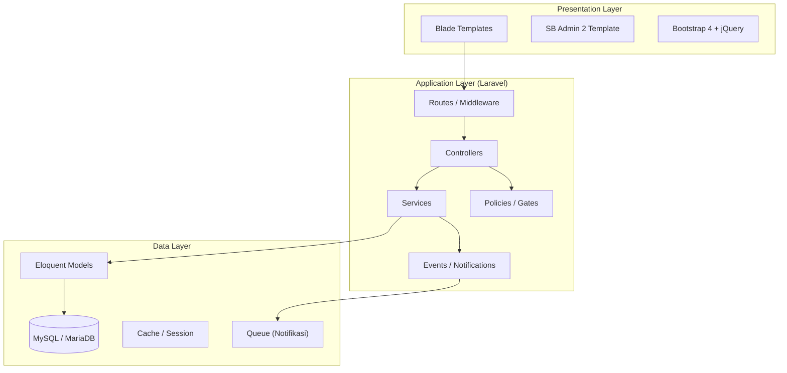
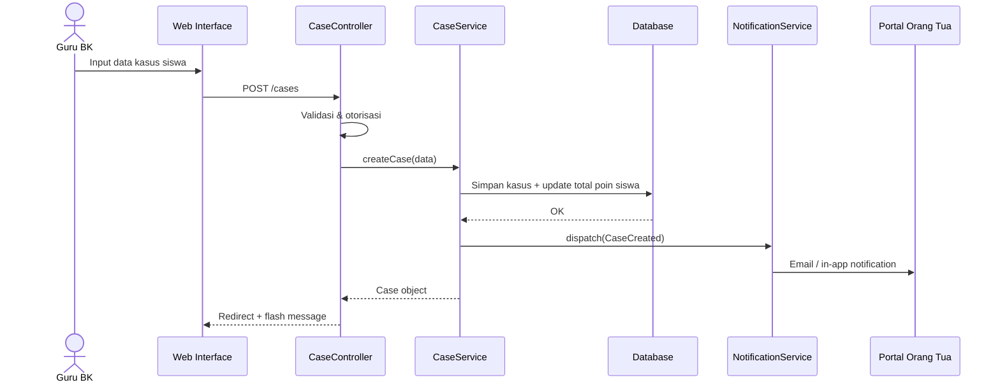
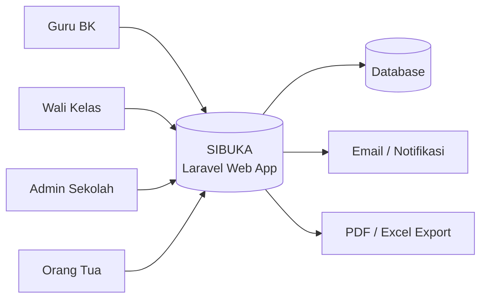
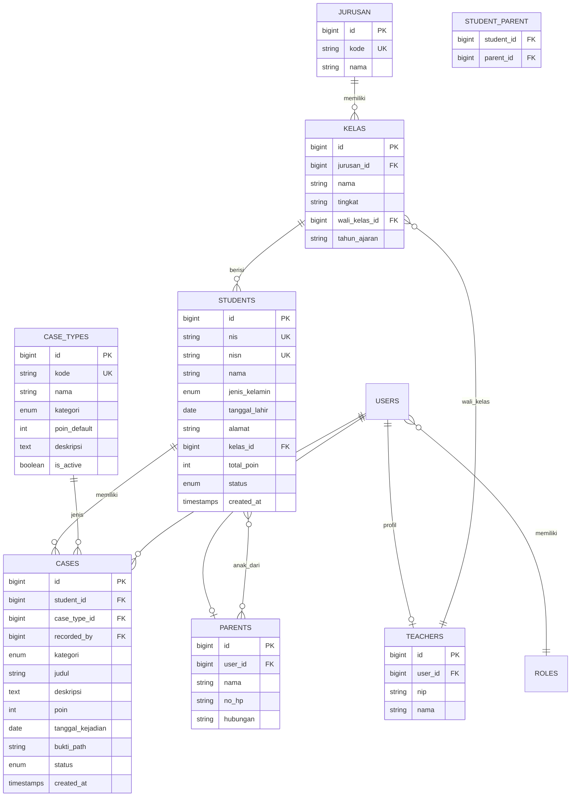
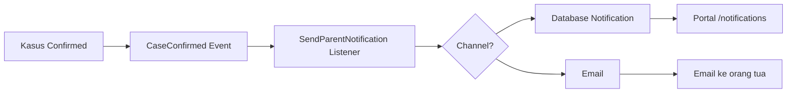

# Dokumentasi Teknis
# Sistem Informasi Buku Kasus (SIBUKA)
### SMK TI Bali Global Klungkung

| Item | Keterangan |
|------|------------|
| **Nama Sistem** | SIBUKA — Sistem Informasi Buku Kasus |
| **Instansi** | SMK TI Bali Global Klungkung |
| **Framework** | Laravel 13.x |
| **Versi Dokumen** | 1.1.0 |
| **Tanggal** | 31 Juli 2026 |
| **Status** | Draft — Fase Perancangan |
| **UI Template** | SB Admin 2 (`template/`) |

---

## Daftar Isi

1. [Ringkasan Eksekutif](#1-ringkasan-eksekutif)
2. [Latar Belakang & Tujuan](#2-latar-belakang--tujuan)
3. [Manfaat Penelitian](#3-manfaat-penelitian)
4. [Ruang Lingkup Sistem](#4-ruang-lingkup-sistem)
5. [Arsitektur Sistem](#5-arsitektur-sistem)
6. [Stack Teknologi](#6-stack-teknologi)
7. [Peran Pengguna & Hak Akses](#7-peran-pengguna--hak-akses)
8. [Desain Basis Data](#8-desain-basis-data)
9. [Spesifikasi Modul](#9-spesifikasi-modul)
10. [Aturan Bisnis & Penghitungan Poin](#10-aturan-bisnis--penghitungan-poin)
11. [Desain API & Routing](#11-desain-api--routing)
12. [Modul Laporan](#12-modul-laporan)
13. [Portal Orang Tua & Notifikasi](#13-portal-orang-tua--notifikasi)
14. [Keamanan](#14-keamanan)
15. [Struktur Direktori Proyek](#15-struktur-direktori-proyek)
16. [Lingkungan Pengembangan & Deployment](#16-lingkungan-pengembangan--deployment)
17. [Rencana Pengembangan](#17-rencana-pengembangan)
18. [Glosarium](#18-glosarium)

---

## 1. Ringkasan Eksekutif

**SIBUKA** (*Sistem Informasi Buku Kasus*) adalah aplikasi web berbasis **Laravel** yang dirancang untuk mendigitalisasi pencatatan, pemantauan, dan pelaporan kasus siswa — baik **pelanggaran** maupun **prestasi** — di SMK TI Bali Global Klungkung.

Sistem menggantikan pencatatan manual buku kasus dengan platform terpusat yang mendukung:

- Manajemen data siswa, kelas, dan jurusan
- Pencatatan kasus dengan sistem poin otomatis
- Laporan per siswa, per kelas, dan seluruh sekolah
- Portal monitoring untuk orang tua/wali siswa

---

## 2. Latar Belakang & Tujuan

### 2.1 Permasalahan

Pencatatan kasus siswa secara manual rentan terhadap:

- Kehilangan atau kerusakan data
- Kesulitan pencarian riwayat perilaku siswa
- Keterlambatan pembuatan laporan rekap
- Keterbatasan akses orang tua terhadap perkembangan anak

### 2.2 Tujuan Sistem

| No | Tujuan |
|----|--------|
| 1 | Menyediakan platform digital untuk pencatatan kasus siswa |
| 2 | Mengotomatisasi penghitungan poin pelanggaran dan prestasi |
| 3 | Menyediakan laporan yang dapat di-generate dan dicetak |
| 4 | Memfasilitasi monitoring kasus oleh wali kelas dan sekolah |
| 5 | Memberikan portal akses bagi orang tua untuk melihat perkembangan anak |

---

## 3. Manfaat Penelitian

### 3.1 Bagi Guru BK (Bimbingan Konseling)

1. Memudahkan pencatatan kasus secara terstruktur dan cepat
2. Data tersimpan aman di basis data dan dapat dicetak kapan saja
3. Memiliki riwayat perkembangan perilaku siswa untuk evaluasi jangka panjang

### 3.2 Bagi Wali Kelas

1. Dapat memantau kasus siswa di kelas yang diampu secara real-time
2. Membantu dalam perencanaan dan pelaksanaan pembinaan kelas

### 3.3 Bagi Sekolah (Admin/Kepala Sekolah)

1. Mendapatkan laporan rekap kasus per kelas maupun keseluruhan sekolah
2. Dapat menganalisis tren pelanggaran atau prestasi sebagai bahan kebijakan sekolah

### 3.4 Bagi Orang Tua/Wali Siswa

1. Dapat memantau perkembangan perilaku anak melalui portal web
2. Menerima notifikasi saat terjadi kasus baru terhadap anak

---

## 4. Ruang Lingkup Sistem

Ruang lingkup kerja praktek meliputi modul-modul berikut:

| No | Modul | Deskripsi |
|----|-------|-----------|
| 1 | **Manajemen Data Siswa** | Input, edit, hapus, dan pencarian data siswa |
| 2 | **Manajemen Kasus** | Input pelanggaran maupun prestasi lengkap dengan deskripsi, tanggal, dan poin |
| 3 | **Penghitungan Poin** | Sistem otomatis menambahkan/mengurangi poin berdasarkan jenis kasus |
| 4 | **Laporan Kasus** | Generate laporan per siswa, per kelas, atau seluruh sekolah (PDF/Excel) |
| 5 | **Notifikasi & Monitoring** | Portal web bagi orang tua untuk melihat perkembangan anak |

### 4.1 Di Luar Ruang Lingkup (Out of Scope v1.0)

- Integrasi dengan Dapodik / sistem akademik eksternal
- Aplikasi mobile native (Android/iOS)
- Modul absensi dan nilai akademik
- Pembayaran SPP atau keuangan sekolah

---

## 5. Arsitektur Sistem

### 5.1 Pola Arsitektur

Sistem menggunakan arsitektur **3-Tier (Three-Layer Architecture)** dengan pola **MVC (Model-View-Controller)** bawaan Laravel:



### 5.2 Alur Data Utama — Input Kasus



### 5.3 Diagram Konteks Sistem



---

## 6. Stack Teknologi

### 6.1 Backend

| Komponen | Teknologi | Versi |
|----------|-----------|-------|
| Bahasa | PHP | ^8.3 |
| Framework | Laravel | ^13.8 |
| ORM | Eloquent | Built-in |
| Authentication | Laravel Session Auth (custom views) | Built-in |
| Authorization | Policies + Gates | Built-in |
| PDF Export | barryvdh/laravel-dompdf | ^3.x |
| Excel Export | maatwebsite/excel | ^3.x |
| Testing | Pest PHP | ^5.0 |

### 6.2 Frontend

| Komponen | Teknologi | Versi |
|----------|-----------|-------|
| Template Engine | Blade | Built-in |
| **Admin Template** | **SB Admin 2** (Start Bootstrap) | 4.1.3 |
| CSS Framework | Bootstrap | 4.6.0 |
| Icon | Font Awesome Free | 5.15.3 |
| JavaScript | jQuery | 3.6.0 |
| Data Table | DataTables (Bootstrap 4) | 1.10.24 |
| Chart | Chart.js | 2.9.4 |
| Font | Nunito (Google Fonts) | — |

> **Sumber template:** Folder `template/` di root proyek. Template HTML statis dikonversi menjadi layout Blade dan partial view Laravel.

### 6.3 UI Template — SB Admin 2

SIBUKA menggunakan **Start Bootstrap SB Admin 2** sebagai kerangka UI admin. Template tersedia di direktori `template/` dan **tidak diubah langsung** — hanya dijadikan referensi saat membuat view Blade.

#### Struktur Folder Template

```
template/
├── index.html              # Dashboard (widget cards, charts)
├── login.html              # Halaman login
├── forgot-password.html    # Lupa password
├── register.html           # Register (tidak dipakai publik)
├── blank.html              # Layout dasar (sidebar + content)
├── tables.html             # DataTables
├── charts.html             # Chart.js
├── cards.html              # Card components
├── buttons.html            # Tombol & form
├── 404.html                # Halaman error
├── css/sb-admin-2.min.css  # Stylesheet utama
├── js/sb-admin-2.min.js    # Script sidebar & toggle
├── vendor/                 # Bootstrap, jQuery, Font Awesome, DataTables
└── img/                    # Asset gambar
```

#### Pemetaan Halaman Template → Modul SIBUKA

| File Template | Digunakan Untuk |
|---------------|-----------------|
| `login.html` | Halaman login (`auth/login`) |
| `forgot-password.html` | Reset password |
| `index.html` | Dashboard Admin / Guru BK |
| `blank.html` | Layout master semua halaman admin |
| `tables.html` | Index siswa, kasus, jurusan, kelas, user |
| `cards.html` | Widget statistik dashboard |
| `charts.html` | Grafik tren pelanggaran/prestasi |
| `buttons.html` | Form create/edit |
| `404.html` | Halaman error 404 |

#### Integrasi Asset ke Laravel

Asset template disalin ke `public/assets/sb-admin-2/` agar dapat diakses via `asset()`:

```
public/assets/sb-admin-2/
├── css/sb-admin-2.min.css
├── js/sb-admin-2.min.js
├── vendor/          # bootstrap, jquery, fontawesome, datatables
└── img/
```

#### Struktur Layout Blade

```
resources/views/
├── layouts/
│   ├── app.blade.php       # Master layout (dari blank.html)
│   ├── auth.blade.php      # Layout login (dari login.html)
│   └── portal.blade.php    # Layout portal orang tua
├── partials/
│   ├── sidebar.blade.php   # Sidebar dinamis per role
│   ├── topbar.blade.php    # Top navigation bar
│   ├── footer.blade.php
│   ├── alerts.blade.php    # Flash message Bootstrap alert
│   └── scripts.blade.php   # jQuery, Bootstrap, SB Admin 2 JS
└── components/
    ├── stat-card.blade.php # Widget card (border-left-primary, dll.)
    └── page-heading.blade.php
```

#### Menu Sidebar per Role

| Menu | Icon FA | Admin | Guru BK | Wali Kelas | Orang Tua |
|------|---------|:-----:|:-------:|:----------:|:---------:|
| Dashboard | `fa-tachometer-alt` | ✅ | ✅ | ✅ | ✅ |
| Data Siswa | `fa-user-graduate` | ✅ | ✅ | ✅ | ❌ |
| Kasus | `fa-clipboard-list` | ✅ | ✅ | ❌ | ❌ |
| Laporan | `fa-file-alt` | ✅ | ✅ | ✅ | ❌ |
| Jurusan | `fa-school` | ✅ | ❌ | ❌ | ❌ |
| Kelas | `fa-users` | ✅ | ❌ | ❌ | ❌ |
| Jenis Kasus | `fa-tags` | ✅ | 👁️ | ❌ | ❌ |
| Pengguna | `fa-user-cog` | ✅ | ❌ | ❌ | ❌ |
| Portal Anak | `fa-child` | ❌ | ❌ | ❌ | ✅ |
| Notifikasi | `fa-bell` | ❌ | ❌ | ❌ | ✅ |

#### Konvensi UI

- Warna utama sidebar: `bg-gradient-primary` (biru SB Admin 2)
- Card statistik: `border-left-primary`, `border-left-success`, `border-left-warning`, `border-left-danger`
- Tabel data: DataTables Bootstrap 4 (`tables.html`)
- Form: Bootstrap 4 form classes (`form-control`, `form-group`)
- Alert flash: Bootstrap `alert alert-success` / `alert-danger`
- Badge kategori: `badge badge-danger` (pelanggaran), `badge badge-success` (prestasi)
- Badge poin: `badge badge-warning` (negatif), `badge badge-info` (positif)

### 6.4 Database & Infrastructure

| Komponen | Teknologi |
|----------|-----------|
| Database | MySQL 8.x / MariaDB 10.x |
| Web Server | Nginx / Apache |
| Cache | File / Redis (production) |
| Queue | Database / Redis |
| Version Control | Git |

### 6.5 Dependensi yang Direkomendasikan

```bash
# Export laporan
composer require barryvdh/laravel-dompdf
composer require maatwebsite/excel

# Auth: Laravel built-in (Session) + view custom dari template/login.html
# UI: SB Admin 2 dari folder template/ (tidak perlu npm build untuk admin UI)
# Role: custom enum + middleware (tidak pakai spatie/laravel-permission)
```

#### Setup Asset Template

```bash
# Salin asset SB Admin 2 ke public (Windows PowerShell)
Copy-Item -Recurse template\css public\assets\sb-admin-2\css
Copy-Item -Recurse template\js public\assets\sb-admin-2\js
Copy-Item -Recurse template\vendor public\assets\sb-admin-2\vendor
Copy-Item -Recurse template\img public\assets\sb-admin-2\img
```

---

## 7. Peran Pengguna & Hak Akses

### 7.1 Daftar Role

| Role | Kode | Deskripsi |
|------|------|-----------|
| Super Admin | `admin` | Mengelola seluruh data master, user, dan konfigurasi sistem |
| Guru BK | `guru_bk` | Input, edit, hapus kasus; lihat semua riwayat siswa |
| Wali Kelas | `wali_kelas` | Lihat & cetak kasus siswa di kelas yang diampu |
| Orang Tua | `orang_tua` | Lihat riwayat kasus anak via portal (read-only) |

### 7.2 Matriks Hak Akses (RBAC)

| Fitur | Admin | Guru BK | Wali Kelas | Orang Tua |
|-------|:-----:|:-------:|:----------:|:---------:|
| Kelola user | ✅ | ❌ | ❌ | ❌ |
| Kelola jurusan & kelas | ✅ | ❌ | ❌ | ❌ |
| CRUD data siswa | ✅ | ✅ | 👁️ | ❌ |
| CRUD kasus | ✅ | ✅ | ❌ | ❌ |
| Lihat kasus semua siswa | ✅ | ✅ | ❌ | ❌ |
| Lihat kasus kelas sendiri | ✅ | ✅ | ✅ | ❌ |
| Lihat kasus anak sendiri | ✅ | ✅ | ❌ | ✅ |
| Generate laporan sekolah | ✅ | ✅ | ❌ | ❌ |
| Generate laporan kelas | ✅ | ✅ | ✅ | ❌ |
| Generate laporan siswa | ✅ | ✅ | ✅ | ✅ |
| Kelola master jenis kasus | ✅ | 👁️ | ❌ | ❌ |
| Export PDF/Excel | ✅ | ✅ | ✅ | ✅ |

> **Keterangan:** ✅ = penuh, 👁️ = baca saja, ❌ = tidak ada akses

### 7.3 Implementasi Authorization

```php
// app/Enums/UserRole.php
enum UserRole: string
{
    case Admin = 'admin';
    case GuruBk = 'guru_bk';
    case WaliKelas = 'wali_kelas';
    case OrangTua = 'orang_tua';
}
```

Authorization diimplementasikan melalui:
- **Middleware** `role:admin,guru_bk` pada route group
- **Policy** per model (`StudentPolicy`, `CasePolicy`, `ReportPolicy`)
- **Gate** untuk aksi khusus seperti `view-class-cases`

---

## 8. Desain Basis Data

### 8.1 Entity Relationship Diagram (ERD)



### 8.2 Definisi Tabel

#### `users`

| Kolom | Tipe | Keterangan |
|-------|------|------------|
| id | BIGINT PK | Primary key |
| name | VARCHAR(255) | Nama lengkap |
| email | VARCHAR(255) UNIQUE | Email login |
| password | VARCHAR(255) | Hash bcrypt |
| role | ENUM | admin, guru_bk, wali_kelas, orang_tua |
| is_active | BOOLEAN | Status akun |
| email_verified_at | TIMESTAMP | Verifikasi email |
| remember_token | VARCHAR(100) | Remember me |
| created_at, updated_at | TIMESTAMP | Audit trail |

#### `students`

| Kolom | Tipe | Keterangan |
|-------|------|------------|
| id | BIGINT PK | Primary key |
| nis | VARCHAR(20) UNIQUE | Nomor Induk Siswa |
| nisn | VARCHAR(20) UNIQUE NULL | NISN nasional |
| nama | VARCHAR(255) | Nama lengkap siswa |
| jenis_kelamin | ENUM(L,P) | Laki-laki / Perempuan |
| tanggal_lahir | DATE | Tanggal lahir |
| alamat | TEXT NULL | Alamat siswa |
| no_hp | VARCHAR(20) NULL | Kontak siswa |
| foto | VARCHAR(255) NULL | Path foto |
| kelas_id | BIGINT FK | Relasi ke kelas |
| total_poin | INT DEFAULT 0 | Akumulasi poin (cache) |
| status | ENUM | aktif, lulus, pindah, dropout |
| created_at, updated_at | TIMESTAMP | Audit trail |

#### `case_types` (Master Jenis Kasus)

| Kolom | Tipe | Keterangan |
|-------|------|------------|
| id | BIGINT PK | Primary key |
| kode | VARCHAR(20) UNIQUE | Kode referensi (PLG-001) |
| nama | VARCHAR(255) | Nama jenis kasus |
| kategori | ENUM | pelanggaran, prestasi |
| poin_default | INT | Poin default (+/-) |
| deskripsi | TEXT NULL | Penjelasan |
| is_active | BOOLEAN DEFAULT true | Status aktif |

#### `cases` (Kasus Siswa)

| Kolom | Tipe | Keterangan |
|-------|------|------------|
| id | BIGINT PK | Primary key |
| student_id | BIGINT FK | Siswa terkait |
| case_type_id | BIGINT FK | Jenis kasus |
| recorded_by | BIGINT FK | User pencatat (Guru BK) |
| kategori | ENUM | pelanggaran, prestasi |
| judul | VARCHAR(255) | Ringkasan kasus |
| deskripsi | TEXT | Detail kejadian |
| poin | INT | Poin kasus (+ prestasi, - pelanggaran) |
| tanggal_kejadian | DATE | Tanggal kejadian |
| bukti_path | VARCHAR(255) NULL | Lampiran bukti |
| status | ENUM | draft, confirmed, archived |
| created_at, updated_at | TIMESTAMP | Audit trail |

#### `jurusan`

| Kolom | Tipe | Keterangan |
|-------|------|------------|
| id | BIGINT PK | Primary key |
| kode | VARCHAR(10) UNIQUE | Kode jurusan (RPL, TKJ) |
| nama | VARCHAR(255) | Nama jurusan |

#### `kelas`

| Kolom | Tipe | Keterangan |
|-------|------|------------|
| id | BIGINT PK | Primary key |
| jurusan_id | BIGINT FK | Jurusan |
| nama | VARCHAR(50) | Nama kelas (XII RPL 1) |
| tingkat | ENUM | X, XI, XII |
| wali_kelas_id | BIGINT FK NULL | User wali kelas |
| tahun_ajaran | VARCHAR(9) | 2025/2026 |

#### `parents` & `student_parent` (Pivot)

Relasi many-to-many antara siswa dan orang tua. Satu siswa dapat memiliki lebih dari satu wali (ayah/ibu/wali).

#### `point_logs` (Audit Poin)

| Kolom | Tipe | Keterangan |
|-------|------|------------|
| id | BIGINT PK | Primary key |
| student_id | BIGINT FK | Siswa |
| case_id | BIGINT FK NULL | Kasus terkait |
| poin_sebelum | INT | Saldo sebelum |
| poin_perubahan | INT | Delta poin |
| poin_sesudah | INT | Saldo setelah |
| keterangan | VARCHAR(255) | Alasan perubahan |
| created_at | TIMESTAMP | Waktu perubahan |

### 8.3 Index & Constraint

```sql
-- Index untuk pencarian cepat
CREATE INDEX idx_students_kelas ON students(kelas_id);
CREATE INDEX idx_students_nis ON students(nis);
CREATE INDEX idx_cases_student ON cases(student_id);
CREATE INDEX idx_cases_tanggal ON cases(tanggal_kejadian);
CREATE INDEX idx_cases_kategori ON cases(kategori);

-- Composite index untuk laporan
CREATE INDEX idx_cases_student_date ON cases(student_id, tanggal_kejadian);
CREATE INDEX idx_cases_kelas_report ON cases(kategori, tanggal_kejadian);
```

---

## 9. Spesifikasi Modul

### 9.1 Modul Manajemen Data Siswa

**Tujuan:** Mengelola data master siswa sekolah.

#### Fitur

| Fitur | Deskripsi |
|-------|-----------|
| Tambah Siswa | Form input NIS, NISN, biodata, kelas |
| Edit Siswa | Update data siswa & pindah kelas |
| Hapus Siswa | Soft delete dengan validasi (tidak bisa jika masih ada kasus aktif) |
| Pencarian | Filter by NIS, nama, kelas, jurusan, status |
| Import Massal | Upload Excel/CSV template siswa |
| Detail Siswa | Profil lengkap + riwayat kasus + grafik poin |

#### Validasi Input

```
nis         : required, unique, max:20
nisn        : nullable, unique, max:20
nama        : required, max:255
jenis_kelamin: required, in:L,P
tanggal_lahir: required, date, before:today
kelas_id    : required, exists:kelas,id
status      : required, in:aktif,lulus,pindah,dropout
```

#### Controller & Service

```
app/Http/Controllers/StudentController.php
app/Services/StudentService.php
app/Http/Requests/StoreStudentRequest.php
app/Http/Requests/UpdateStudentRequest.php
app/Models/Student.php
```

---

### 9.2 Modul Manajemen Kasus

**Tujuan:** Mencatat pelanggaran dan prestasi siswa secara terstruktur.

#### Fitur

| Fitur | Deskripsi |
|-------|-----------|
| Tambah Kasus | Pilih siswa, jenis kasus, isi detail |
| Edit Kasus | Update kasus (hanya status draft/confirmed) |
| Hapus Kasus | Soft delete + rollback poin |
| Filter Kasus | By siswa, kelas, kategori, rentang tanggal |
| Upload Bukti | Lampiran foto/dokumen (max 2MB) |
| Riwayat Kasus | Timeline kasus per siswa |

#### Form Input Kasus

| Field | Tipe | Wajib |
|-------|------|-------|
| student_id | Select (searchable) | ✅ |
| case_type_id | Select | ✅ |
| kategori | Radio: pelanggaran/prestasi | ✅ |
| judul | Text | ✅ |
| deskripsi | Textarea | ✅ |
| poin | Number (auto-fill dari master, bisa override) | ✅ |
| tanggal_kejadian | Date | ✅ |
| bukti | File (jpg,png,pdf) | ❌ |

#### Status Kasus

| Status | Deskripsi |
|--------|-----------|
| `draft` | Kasus baru, belum final |
| `confirmed` | Kasus disahkan, poin sudah dihitung |
| `archived` | Kasus diarsipkan (tidak dihitung ulang) |

---

### 9.3 Modul Penghitungan Poin

**Tujuan:** Otomatisasi akumulasi poin pelanggaran dan prestasi.

#### Alur Penghitungan

```mermaid
flowchart TD
    A[Kasus Baru Dibuat] --> B{Status = confirmed?}
    B -->|Tidak| C[Simpan tanpa update poin]
    B -->|Ya| D{Kategori?}
    D -->|Pelanggaran| E[poin = -abs(poin_default)]
    D -->|Prestasi| F[poin = +abs(poin_default)]
    E --> G[Update students.total_poin]
    F --> G
    G --> H[Catat ke point_logs]
    H --> I{total_poin <= batas?}
    I -->|Ya, pelanggaran| J[Trigger alert BK]
    I -->|Tidak| K[Selesai]
    J --> K
```

#### Service Layer

```php
// app/Services/PointService.php

class PointService
{
    public function applyCasePoints(CaseRecord $case): void
    {
        // 1. Hitung delta poin berdasarkan kategori
        // 2. Update students.total_poin
        // 3. Insert ke point_logs
        // 4. Cek threshold → dispatch alert jika perlu
    }

    public function rollbackCasePoints(CaseRecord $case): void
    {
        // Reverse poin saat kasus dihapus/diarsipkan
    }

    public function recalculateStudentPoints(Student $student): int
    {
        // Recalculate dari semua kasus confirmed (maintenance)
    }
}
```

#### Konfigurasi Threshold (via `config/sibuka.php`)

```php
return [
    'point_thresholds' => [
        'warning'  => -25,  // Peringatan BK
        'sp1'      => -50,  // Surat Peringatan 1
        'sp2'      => -75,  // Surat Peringatan 2
        'sp3'      => -100, // Surat Peringatan 3
    ],
    'prestasi_bonus' => [
        'juara_kelas' => 20,
        'juara_sekolah' => 50,
    ],
];
```

---

### 9.4 Modul Master Data

| Entitas | Fitur |
|---------|-------|
| Jurusan | CRUD jurusan (RPL, TKJ, DKV, dll.) |
| Kelas | CRUD kelas + assign wali kelas |
| Jenis Kasus | CRUD template pelanggaran/prestasi + poin default |
| Pengguna | CRUD akun + assign role |
| Tahun Ajaran | Konfigurasi periode aktif |

---

## 10. Aturan Bisnis & Penghitungan Poin

### 10.1 Aturan Umum

| No | Aturan |
|----|--------|
| 1 | Poin pelanggaran selalu **negatif** (−) |
| 2 | Poin prestasi selalu **positif** (+) |
| 3 | Poin dihitung otomatis saat kasus status = `confirmed` |
| 4 | Edit kasus yang sudah confirmed → recalculate poin |
| 5 | Hapus kasus → rollback poin ke `point_logs` |
| 6 | `students.total_poin` adalah cache; sumber kebenaran = agregasi `cases` |
| 7 | Hanya Guru BK dan Admin yang dapat CRUD kasus |
| 8 | Wali Kelas hanya dapat melihat, tidak mengedit kasus |

### 10.2 Contoh Master Jenis Kasus

| Kode | Nama | Kategori | Poin Default |
|------|------|----------|:------------:|
| PLG-001 | Terlambat masuk sekolah | pelanggaran | -5 |
| PLG-002 | Tidak memakai seragam lengkap | pelanggaran | -10 |
| PLG-003 | Bolos pelajaran | pelanggaran | -25 |
| PLG-004 | Berkelahi | pelanggaran | -50 |
| PRS-001 | Juara lomba tingkat kelas | prestasi | +20 |
| PRS-002 | Juara lomba tingkat sekolah | prestasi | +50 |
| PRS-003 | Siswa teladan bulanan | prestasi | +30 |

### 10.3 Rumus Total Poin

```
total_poin = Σ (poin kasus confirmed WHERE kategori = prestasi)
           + Σ (poin kasus confirmed WHERE kategori = pelanggaran)

Contoh:
  Prestasi: +20 + +30 = +50
  Pelanggaran: -5 + -10 + -25 = -40
  Total: +50 + (-40) = +10
```

---

## 11. Desain API & Routing

### 11.1 Struktur Route (web.php)

```php
// routes/web.php

Route::middleware('guest')->group(function () {
    Route::get('/login', [AuthController::class, 'showLogin'])->name('login');
    Route::post('/login', [AuthController::class, 'login']);
});

Route::middleware(['auth', 'active'])->group(function () {

    Route::get('/dashboard', [DashboardController::class, 'index'])->name('dashboard');

    // Admin only
    Route::middleware('role:admin')->group(function () {
        Route::resource('users', UserController::class);
        Route::resource('jurusan', JurusanController::class);
        Route::resource('case-types', CaseTypeController::class);
    });

    // Admin + Guru BK
    Route::middleware('role:admin,guru_bk')->group(function () {
        Route::resource('students', StudentController::class);
        Route::post('students/import', [StudentController::class, 'import'])->name('students.import');
        Route::resource('cases', CaseController::class);
        Route::patch('cases/{case}/confirm', [CaseController::class, 'confirm'])->name('cases.confirm');
    });

    // Admin + Guru BK + Wali Kelas
    Route::middleware('role:admin,guru_bk,wali_kelas')->group(function () {
        Route::get('reports', [ReportController::class, 'index'])->name('reports.index');
        Route::get('reports/student/{student}', [ReportController::class, 'student'])->name('reports.student');
        Route::get('reports/class/{kelas}', [ReportController::class, 'class'])->name('reports.class');
        Route::get('reports/school', [ReportController::class, 'school'])->name('reports.school');
    });

    // Orang Tua portal
    Route::middleware('role:orang_tua')->prefix('portal')->name('portal.')->group(function () {
        Route::get('/', [PortalController::class, 'index'])->name('index');
        Route::get('/children/{student}', [PortalController::class, 'show'])->name('child');
        Route::get('/notifications', [PortalController::class, 'notifications'])->name('notifications');
    });
});
```

### 11.2 Endpoint Summary

| Method | URI | Nama Route | Role | Deskripsi |
|--------|-----|------------|------|-----------|
| GET | `/dashboard` | dashboard | All | Halaman utama |
| GET/POST | `/students` | students.* | admin, guru_bk | CRUD siswa |
| GET/POST | `/cases` | cases.* | admin, guru_bk | CRUD kasus |
| PATCH | `/cases/{id}/confirm` | cases.confirm | admin, guru_bk | Konfirmasi kasus |
| GET | `/reports/student/{id}` | reports.student | admin, guru_bk, wali_kelas | Laporan siswa |
| GET | `/reports/class/{id}` | reports.class | admin, guru_bk, wali_kelas | Laporan kelas |
| GET | `/reports/school` | reports.school | admin, guru_bk | Laporan sekolah |
| GET | `/portal` | portal.index | orang_tua | Dashboard orang tua |
| GET | `/portal/children/{id}` | portal.child | orang_tua | Detail anak |

### 11.3 Response Format (JSON API — opsional)

Jika diperlukan API untuk integrasi future:

```json
{
  "success": true,
  "message": "Kasus berhasil dicatat",
  "data": {
    "id": 42,
    "student": { "id": 1, "nama": "I Made Example", "nis": "2024001" },
    "kategori": "pelanggaran",
    "judul": "Terlambat masuk sekolah",
    "poin": -5,
    "tanggal_kejadian": "2026-07-30",
    "total_poin_siswa": 15
  }
}
```

---

## 12. Modul Laporan

### 12.1 Jenis Laporan

| Laporan | Parameter Filter | Output |
|---------|-----------------|--------|
| **Per Siswa** | student_id, rentang tanggal | PDF, Excel |
| **Per Kelas** | kelas_id, kategori, rentang tanggal | PDF, Excel |
| **Seluruh Sekolah** | jurusan, tingkat, kategori, rentang tanggal | PDF, Excel |
| **Rekap Poin** | kelas_id, periode | PDF |
| **Tren Pelanggaran** | periode (bulanan/tahunan) | PDF, Chart |

### 12.2 Konten Laporan Per Siswa

```
┌─────────────────────────────────────────────────┐
│  SMK TI BALI GLOBAL KLUNGKUNG                   │
│  LAPORAN BUKU KASUS SISWA                       │
├─────────────────────────────────────────────────┤
│  NIS      : 2024001                             │
│  Nama     : I Made Example                      │
│  Kelas    : XII RPL 1                           │
│  Periode  : Januari 2026 – Juli 2026            │
│  Total Poin: +10                                │
├─────────────────────────────────────────────────┤
│  No │ Tanggal   │ Kategori     │ Judul    │ Poin│
│  1  │ 15/03/26  │ Prestasi     │ Juara... │ +20 │
│  2  │ 20/04/26  │ Pelanggaran  │ Terlambat│  -5 │
├─────────────────────────────────────────────────┤
│  Dicetak: 31/07/2026          Guru BK: ________ │
└─────────────────────────────────────────────────┘
```

### 12.3 Implementasi Export

```php
// app/Http/Controllers/ReportController.php

public function student(Student $student, Request $request)
{
    $this->authorize('view', $student);

    $cases = $this->reportService->getStudentCases(
        $student,
        $request->date_from,
        $request->date_to
    );

    if ($request->format === 'pdf') {
        return Pdf::loadView('reports.student-pdf', compact('student', 'cases'))
                  ->download("laporan-{$student->nis}.pdf");
    }

    return Excel::download(
        new StudentCaseExport($student, $cases),
        "laporan-{$student->nis}.xlsx"
    );
}
```

### 12.4 Dashboard Analytics

Widget dashboard Admin/Guru BK:

- Total kasus bulan ini (pelanggaran vs prestasi)
- Top 5 siswa pelanggaran terbanyak
- Top 5 siswa prestasi terbanyak
- Grafik tren pelanggaran 6 bulan terakhir (Chart.js)
- Distribusi kasus per jurusan (pie chart)

---

## 13. Portal Orang Tua & Notifikasi

### 13.1 Portal Orang Tua

**URL:** `/portal`

#### Fitur Portal

| Fitur | Deskripsi |
|-------|-----------|
| Dashboard | Ringkasan semua anak + total poin masing-masing |
| Detail Anak | Riwayat kasus, grafik poin, profil siswa |
| Notifikasi | Daftar notifikasi kasus baru |
| Cetak Laporan | Download PDF riwayat anak |

#### Alur Login Orang Tua

1. Admin/Guru BK membuat akun orang tua
2. Akun di-link ke siswa via tabel `student_parent`
3. Orang tua login dengan email + password
4. Sistem menampilkan hanya data anak yang ter-link

### 13.2 Sistem Notifikasi



#### Trigger Notifikasi

| Event | Penerima | Channel |
|-------|----------|---------|
| Kasus baru confirmed | Orang tua siswa | Database + Email |
| Poin mencapai threshold | Guru BK + Wali Kelas | Database |
| Laporan bulanan | Admin | Email |

#### Implementasi

```php
// app/Notifications/NewCaseNotification.php

class NewCaseNotification extends Notification
{
    public function via($notifiable): array
    {
        return ['mail', 'database'];
    }

    public function toMail($notifiable): MailMessage
    {
        return (new MailMessage)
            ->subject('Pemberitahuan Kasus Siswa - SIBUKA')
            ->line("Anak Anda {$this->case->student->nama} mencatat kasus baru.")
            ->line("Kategori: {$this->case->kategori}")
            ->line("Judul: {$this->case->judul}")
            ->action('Lihat Detail', url("/portal/children/{$this->case->student_id}"));
    }
}
```

---

## 14. Keamanan

### 14.1 Autentikasi

- Login berbasis email + password (Laravel Session Auth + view `template/login.html`)
- Password minimum 8 karakter, di-hash bcrypt
- Session-based authentication dengan CSRF protection
- Rate limiting login: 5 percobaan / menit
- Remember me dengan secure token

### 14.2 Authorization

- Role-based access control (RBAC) via middleware + policies
- Orang tua hanya akses data anak sendiri (enforced di policy)
- Wali kelas hanya akses kelas yang diampu
- Mass assignment protection via `$fillable` / `$guarded`

### 14.3 Proteksi Data

| Aspek | Implementasi |
|-------|-------------|
| SQL Injection | Eloquent ORM + prepared statements |
| XSS | Blade auto-escaping `{{ }}` |
| CSRF | `@csrf` token di semua form |
| File Upload | Validasi MIME type, max size, stored outside public |
| Data Privacy | Soft delete, audit log di `point_logs` |
| HTTPS | Wajib di production |

### 14.4 Audit Trail

Semua aksi kritikal dicatat:

```php
// Log activity (bisa menggunakan spatie/laravel-activitylog)
activity()
    ->performedOn($case)
    ->causedBy(auth()->user())
    ->withProperties(['poin' => $case->poin])
    ->log('Kasus baru dicatat');
```

---

## 15. Struktur Direktori Proyek

```
SIBUKA/
├── app/
│   ├── Enums/
│   │   ├── UserRole.php
│   │   ├── CaseCategory.php
│   │   └── CaseStatus.php
│   ├── Events/
│   │   └── CaseConfirmed.php
│   ├── Http/
│   │   ├── Controllers/
│   │   │   ├── Auth/
│   │   │   ├── CaseController.php
│   │   │   ├── CaseTypeController.php
│   │   │   ├── DashboardController.php
│   │   │   ├── JurusanController.php
│   │   │   ├── KelasController.php
│   │   │   ├── PortalController.php
│   │   │   ├── ReportController.php
│   │   │   ├── StudentController.php
│   │   │   └── UserController.php
│   │   ├── Middleware/
│   │   │   ├── EnsureUserIsActive.php
│   │   │   └── CheckRole.php
│   │   └── Requests/
│   │       ├── StoreCaseRequest.php
│   │       ├── StoreStudentRequest.php
│   │       └── UpdateStudentRequest.php
│   ├── Listeners/
│   │   └── SendParentNotification.php
│   ├── Models/
│   │   ├── CaseRecord.php
│   │   ├── CaseType.php
│   │   ├── Jurusan.php
│   │   ├── Kelas.php
│   │   ├── ParentModel.php
│   │   ├── PointLog.php
│   │   ├── Student.php
│   │   ├── Teacher.php
│   │   └── User.php
│   ├── Notifications/
│   │   ├── NewCaseNotification.php
│   │   └── PointThresholdNotification.php
│   ├── Policies/
│   │   ├── CasePolicy.php
│   │   ├── ReportPolicy.php
│   │   └── StudentPolicy.php
│   ├── Services/
│   │   ├── CaseService.php
│   │   ├── PointService.php
│   │   ├── ReportService.php
│   │   └── StudentService.php
│   └── Exports/
│       ├── ClassCaseExport.php
│       └── StudentCaseExport.php
├── config/
│   └── sibuka.php                  # Konfigurasi threshold poin
├── database/
│   ├── migrations/
│   │   ├── create_jurusan_table.php
│   │   ├── create_kelas_table.php
│   │   ├── create_students_table.php
│   │   ├── create_case_types_table.php
│   │   ├── create_cases_table.php
│   │   ├── create_parents_table.php
│   │   ├── create_student_parent_table.php
│   │   ├── create_teachers_table.php
│   │   ├── create_point_logs_table.php
│   │   └── add_role_to_users_table.php
│   ├── seeders/
│   │   ├── DatabaseSeeder.php
│   │   ├── RoleSeeder.php
│   │   ├── JurusanSeeder.php
│   │   ├── CaseTypeSeeder.php
│   │   └── DemoDataSeeder.php
│   └── factories/
├── docs/
│   └── TECHNICAL_DOCUMENTATION.md  # Dokumen ini
├── template/                       # SB Admin 2 HTML template (referensi UI)
│   ├── index.html, login.html, blank.html, tables.html, ...
│   ├── css/, js/, vendor/, img/
├── public/assets/sb-admin-2/       # Asset template (disalin dari template/)
├── resources/
│   ├── views/
│   │   ├── layouts/
│   │   │   ├── app.blade.php       # Master layout (dari blank.html)
│   │   │   ├── auth.blade.php      # Layout login (dari login.html)
│   │   │   └── portal.blade.php    # Layout portal orang tua
│   │   ├── partials/
│   │   │   ├── sidebar.blade.php
│   │   │   ├── topbar.blade.php
│   │   │   ├── footer.blade.php
│   │   │   ├── alerts.blade.php
│   │   │   └── scripts.blade.php
│   │   ├── components/
│   │   │   ├── stat-card.blade.php
│   │   │   └── page-heading.blade.php
│   │   ├── auth/
│   │   │   └── login.blade.php
│   │   ├── dashboard/
│   │   ├── students/
│   │   ├── cases/
│   │   ├── reports/
│   │   ├── portal/
│   │   └── pdf/
│   │       ├── student-report.blade.php
│   │       ├── class-report.blade.php
│   │       └── school-report.blade.php
│   ├── css/
│   └── js/
├── routes/
│   ├── web.php
│   └── console.php
├── tests/
│   ├── Feature/
│   │   ├── StudentTest.php
│   │   ├── CaseTest.php
│   │   ├── PointCalculationTest.php
│   │   └── ReportTest.php
│   └── Unit/
│       └── PointServiceTest.php
├── .env.example
├── composer.json
└── package.json
```

---

## 16. Lingkungan Pengembangan & Deployment

### 16.1 Prasyarat

| Software | Versi Minimum |
|----------|---------------|
| PHP | 8.3+ |
| Composer | 2.x |
| Node.js | 20.x+ |
| MySQL / MariaDB | 8.0 / 10.6 |
| Git | 2.x |

### 16.2 Setup Lokal

```bash
# Clone & install
git clone <repo-url> SIBUKA
cd SIBUKA
composer install
cp .env.example .env
php artisan key:generate

# Konfigurasi database di .env
# DB_DATABASE=sibuka
# DB_USERNAME=root
# DB_PASSWORD=

php artisan migrate --seed

# Salin asset UI SB Admin 2 ke public
# Windows: lihat IMPLEMENTATION_DOCUMENTATION.md §4.2
# Linux: cp -r template/{css,js,vendor,img} public/assets/sb-admin-2/

# Jalankan development server
php artisan serve
# Akses: http://localhost:8000
```

### 16.3 Environment Variables

```env
APP_NAME=SIBUKA
APP_ENV=local
APP_URL=http://localhost:8000

DB_CONNECTION=mysql
DB_HOST=127.0.0.1
DB_PORT=3306
DB_DATABASE=sibuka
DB_USERNAME=root
DB_PASSWORD=

MAIL_MAILER=smtp
MAIL_HOST=smtp.gmail.com
MAIL_PORT=587
MAIL_USERNAME=
MAIL_PASSWORD=
MAIL_FROM_ADDRESS=noreply@sibuka.smkbaliglobalklungkung.sch.id
MAIL_FROM_NAME="SIBUKA SMK TI Bali Global"

# Konfigurasi SIBUKA
SIBUKA_SCHOOL_NAME="SMK TI Bali Global Klungkung"
SIBUKA_POINT_WARNING=-25
SIBUKA_POINT_SP1=-50
SIBUKA_POINT_SP2=-75
SIBUKA_POINT_SP3=-100
```

### 16.4 Deployment Production

```bash
# Di server production
composer install --optimize-autoloader --no-dev
php artisan config:cache
php artisan route:cache
php artisan view:cache
php artisan migrate --force
php artisan storage:link

# Pastikan asset SB Admin 2 ada di public/assets/sb-admin-2/

# Set permission
chmod -R 775 storage bootstrap/cache
chown -R www-data:www-data storage bootstrap/cache
```

#### Checklist Production

- [ ] `APP_ENV=production`, `APP_DEBUG=false`
- [ ] HTTPS enabled (SSL certificate)
- [ ] Database backup otomatis (daily)
- [ ] Queue worker running (`php artisan queue:work`)
- [ ] Scheduler cron: `* * * * * php artisan schedule:run`
- [ ] File storage linked: `php artisan storage:link`

---

## 17. Rencana Pengembangan

### Fase 1 — Fondasi (Minggu 1–2)

- [ ] Salin asset SB Admin 2 dari `template/` ke `public/assets/sb-admin-2/`
- [ ] Buat layout Blade dari `template/blank.html` dan `template/login.html`
- [ ] Setup autentikasi Laravel Session (view custom, bukan Breeze)
- [ ] Migration semua tabel
- [ ] Seeder data master (jurusan, jenis kasus, admin)
- [ ] Middleware role & policies dasar
- [ ] Sidebar dinamis per role + dashboard skeleton (dari `template/index.html`)

### Fase 2 — Core Modules (Minggu 3–5)

- [ ] CRUD Manajemen Siswa
- [ ] CRUD Manajemen Kasus
- [ ] PointService + point_logs
- [ ] CRUD Master Data (jurusan, kelas, jenis kasus)
- [ ] Dashboard dengan widget statistik

### Fase 3 — Laporan & Export (Minggu 6–7)

- [ ] Laporan per siswa (PDF + Excel)
- [ ] Laporan per kelas
- [ ] Laporan seluruh sekolah
- [ ] Grafik tren di dashboard

### Fase 4 — Portal & Notifikasi (Minggu 8–9)

- [ ] Portal orang tua
- [ ] Sistem notifikasi (database + email)
- [ ] Alert threshold poin

### Fase 5 — Testing & Deployment (Minggu 10–12)

- [ ] Unit & feature tests (Pest)
- [ ] UAT dengan Guru BK & Wali Kelas
- [ ] Bug fixing
- [ ] Deployment ke server sekolah
- [ ] Dokumentasi user manual

---

## 18. Glosarium

| Istilah | Definisi |
|---------|----------|
| **BK** | Bimbingan Konseling — guru yang menangani konseling siswa |
| **Kasus** | Record pelanggaran atau prestasi siswa |
| **NIS** | Nomor Induk Siswa — identitas siswa di sekolah |
| **NISN** | Nomor Induk Siswa Nasional |
| **Poin** | Nilai numerik yang merepresentasikan berat pelanggaran (−) atau prestasi (+) |
| **RBAC** | Role-Based Access Control — kontrol akses berbasis peran |
| **SIBUKA** | Sistem Informasi Buku Kasus |
| **Soft Delete** | Penghapusan logis (data tidak benar-benar dihapus dari database) |
| **SP** | Surat Peringatan — tindakan disiplin sekolah |
| **Threshold** | Batas poin yang memicu alert/tindakan |
| **Wali Kelas** | Guru yang bertanggung jawab atas satu kelas siswa |

---

## Lampiran

### A. Wireframe Dashboard Guru BK (SB Admin 2)

Berdasarkan `template/index.html` — layout sidebar kiri + content area kanan:

```
┌──────────────┬───────────────────────────────────────────────────┐
│  SIDEBAR     │  TOPBAR: Search | Notifikasi | Profil User         │
│  (primary)   ├───────────────────────────────────────────────────┤
│              │  Dashboard                                         │
│  SIBUKA      │  ─────────────────────────────────────────────    │
│  ─────────   │  Selamat datang, Pak/Ibu [Nama Guru BK]           │
│  Dashboard ● │                                                    │
│  Data Siswa  │  ┌─────────┐ ┌─────────┐ ┌─────────┐ ┌─────────┐ │
│  Kasus       │  │ 156     │ │ 23      │ │ 12      │ │ 8       │ │
│  Laporan     │  │ TOTAL   │ │ KASUS   │ │ PRESTASI│ │ PERLU   │ │
│              │  │ SISWA   │ │ BULAN INI│ │ BULAN INI│ │ ATENSI  │ │
│              │  └─────────┘ └─────────┘ └─────────┘ └─────────┘ │
│              │  (card border-left-primary/success/warning/danger)│
│              │                                                    │
│              │  ┌── Kasus Terbaru ──┐  ┌── Tren 6 Bulan ──────┐ │
│              │  │ DataTables / List  │  │ Chart.js Area Chart  │ │
│              │  └────────────────────┘  └──────────────────────┘ │
│              │                                                    │
│              │  [+ Tambah Kasus Baru]  (btn btn-primary)          │
└──────────────┴───────────────────────────────────────────────────┘
```

Referensi komponen: `template/cards.html` (stat cards), `template/charts.html` (grafik), `template/tables.html` (tabel kasus terbaru).

### B. Template Import Siswa (Excel)

| NIS | NISN | Nama | L | P | Tanggal Lahir | Kelas | Alamat | No HP |
|-----|------|------|---|---|---------------|-------|--------|-------|
| 2024001 | 0051234567 | I Made Example | L | | 2008-05-15 | XII RPL 1 | Denpasar | 08123456789 |

---

> **Catatan:** Dokumen ini akan diperbarui seiring progres pengembangan. Setiap perubahan signifikan pada arsitektur, basis data, atau spesifikasi modul harus tercatat di changelog dokumen.

### Changelog

| Versi | Tanggal | Perubahan |
|-------|---------|-----------|
| 1.0.0 | 2026-07-31 | Dokumen teknis awal |
| 1.1.0 | 2026-07-31 | UI menggunakan SB Admin 2 dari folder `template/` |

**Disusun oleh:** Tim Pengembang SIBUKA  
**Institusi:** SMK TI Bali Global Klungkung  
**Versi:** 1.1.0 | **Tanggal:** 31 Juli 2026
